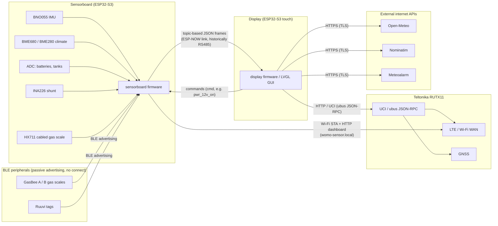

# Architektur-Überblick

WoMoHome ("WoMo Home ESP32") ist ein selbstgebautes digitales Cockpit für ein Wohnmobil auf
Fiat-Ducato-Basis. Es ersetzt das originale EBL (Einbau-Leuchten/Elektronik-Blockbau, das
Schaudt-artige Bedienpanel) des Fahrzeugs durch ein eigenes Sensor-/Displaysystem aus drei
physischen Hardware-Knoten, ergänzt um eine kleine Familie batteriebetriebener BLE-"Gaswaagen"-
Peripheriegeräte. Die gesamte Firmware liegt unter `firmware/` in diesem Repository; es gibt kein
Server-Backend und keine Cloud-Komponente — das System läuft vollständig lokal im Fahrzeug.

## Die drei physischen Knoten

| Node | MCU / Hardware | Firmware-Pfad | Zuständigkeit |
|---|---|---|---|
| **Sensorboard** | Heemol ESP32-S3-WROOM-1 N16R8 DevKitC-1 | [`firmware/sensorboard/`](../../firmware/sensorboard/) | Liest sämtliche analogen/digitalen/I2C-Sensoren (IMU, Klima, Tanks, Batterien, Shunt-Strom, Gasgewicht) und stellt sie als Topic-basierte JSON-Frames bereit; betreibt außerdem ein lokales Wi-Fi-Web-Dashboard und steuert die 12V-/Multimedia-Relais des Fahrzeugs. Siehe [Sensorboard](sensorboard.md). |
| **Display** | Waveshare ESP32-S3-Touch-LCD-7 (ESP32-S3-WROOM-1, 800×480 RGB565 Touch) | [`firmware/display/`](../../firmware/display/) | Betreibt die LVGL-Touch-GUI, führt alle Sensorboard-Topics zusammen und visualisiert sie, lässt den Nutzer den 12V-Bus/Multimedia des Fahrzeugs steuern und kommuniziert mit dem Router für Konnektivität und externe APIs. Siehe [Display](display.md). |
| **Router** | Teltonika RUTX11 (OpenWrt-basiert), Dachantenne mit 2×Wi-Fi + 2×LTE + GNSS | nicht Teil dieses Repositories (kommerzielles Gerät, konfiguriert via UCI) | Stellt Wi-Fi-/LTE-Internet, GPS/GNSS und einen eigenen Hotspot bereit; sowohl Display als auch Sensorboard treten dem Wi-Fi-Netz des Routers als Stationen bei. Siehe [Router und Konnektivität](router-and-connectivity.md). |

Zusätzlich wiegt eine Familie batteriebetriebener **BLE-Gaswaagen-Knoten ("GasBee")** die beiden
Gasflaschen und meldet Gewichts-/Batteriedaten per Bluetooth Low Energy an das Sensorboard; siehe
[BLE Sensor Nodes](ble-sensor-nodes.md). Es existieren zwei Firmware-Varianten: das ursprüngliche
`firmware/gasbee/` (ESP32-C3) und dessen Nachfolger `firmware/gasbee_nrf/` (Seeed XIAO nRF52840),
beide implementieren dasselbe BLE-Advertising-Format v1.

## Datenfluss

Sowohl Display als auch Sensorboard treten dem RUTX11 als Wi-Fi-Stationen bei (`192.168.55.1` ist
die LAN-IP des Routers, siehe `firmware/shared/womo_config.h`). Nur das Display spricht mit dem
UCI/ubus-JSON-RPC-Endpunkt des Routers (Login-Session über HTTP, vor Ablauf der 300-s-Gültigkeit
erneuert), um Wi-Fi-/LTE-/GPS-Zustand zu lesen und zu ändern; das Sensorboard nutzt seine eigene
Wi-Fi-Verbindung nur für NTP-Zeitsynchronisation und zum Bereitstellen seines eigenen lokalen
HTTP-Dashboards (`http://Womo-Sensor.local/`), nicht um die Management-API des Routers zu erreichen.
Ausgehende Internetaufrufe (Wetter, Reverse-Geocoding, Unwetterwarnungen) erfolgen ausschließlich
durch das Display, jeweils über TLS mit eingebettetem Root-Zertifikat.

## Sensorboard-↔-Display-Link: RS485-Bezeichnung vs. die aktuell implementierte ESP-NOW-Umsetzung

Dies ist die wichtigste Tatsache, die man beim Lesen der übrigen Dokumentation dieses Repositories
richtig verstehen sollte, denn die geschriebene Dokumentation und die kompilierte Firmware
widersprechen sich derzeit:

- **Was die Dokumentation sagt (`CLAUDE.md`, `README.md`, `docs/README.md`,
  `firmware/sensorboard/README.md`, `firmware/sensorboard/CLAUDE.md`,
  `firmware/display/CLAUDE.md`):** Sensorboard und Display sind über einen verdrahteten
  RS485-Halbduplex-Bus (57600 8N1, MAX3485-Transceiver) verbunden, der CRLF-terminierte,
  Topic-basierte ASCII-JSON-Frames überträgt ("RS485-Protokoll v2").
- **Was die aktuelle Firmware-Quelle tatsächlich baut und ausführt:** Weder
  `firmware/sensorboard/main/CMakeLists.txt` noch `firmware/display/main/CMakeLists.txt` kompiliert
  noch irgendeine RS485-/UART-Transportdatei. Das Sensorboard kompiliert
  `network/espnow_modem.c` + `network/espnow_transport.c`, und das Display kompiliert
  `espnow/womo_espnow.c`; `app_main.c` ruft `espnow_modem_init()` auf, und
  `firmware/display/main/sensorboard/womo_sensorboard.c` ruft `womo_espnow_init()` auf. Der
  Transport ist **ESP-NOW** (ESP32-Peer-to-Peer-Funk auf 2,4 GHz): Das Sensorboard sendet per
  Broadcast, bis das Display antwortet, lernt dann die MAC-Adresse des Displays und wechselt zu
  Unicast (`firmware/sensorboard/main/network/espnow_transport.c`). Code-Kommentare bezeichnen dies
  ausdrücklich als "ESP-NOW-Migration" und vermerken, dass der RS485-Transceiver aus der Hardware
  entfernt wurde (`firmware/sensorboard/main/hal/deep_sleep.c`,
  `firmware/sensorboard/main/sensor_config.h`); der ausgecheckte Arbeitsstand entspricht dem in
  `firmware/sensorboard/memory-bank/activeContext.md` genannten Branch
  `feature/espnow-migration`.
- **Was gleich geblieben ist:** Das JSON-Topic-Protokoll selbst — Topic-Namen (`hello`, `hb`,
  `ctrl`, `imu`, `bat`, `tank`, `hx`, `gas`, `bme_in`, `bme_out`, `elec`, `ruuvi_scan`,
  `gasbee_scan`, `gasbee_cal_result`), die Pro-Topic-Intervalle aus
  `firmware/shared/womo_config.h`, der Round-Robin-Scheduler sowie das `cmd`/`seq`/`ack`-Framing
  sind unverändert und werden im Quellcode durchgehend noch als "RS485" benannt und kommentiert
  (z. B. `RS485_LINE_MAX`, `rs485_pending_cmd_t`, `RS485_TOPIC_COUNT` in `espnow_modem.c`;
  UI-Beschriftungen wie "RS485 debug status" in `firmware/display/main/main.c`).
  `firmware/shared/womo_config.h` dokumentiert die ESP-NOW-Konstanten sogar unter der Überschrift
  "Kategorie 4: ESP-NOW Transport (ersetzt RS485)" — "ersetzt RS485".

Kurz gesagt: **ESP-NOW ist der aktuell implementierte und aktive Transport zwischen Sensorboard und
Display**; der verdrahtete RS485-Link, den es ersetzt, wird in keines der beiden Firmware-Images
mehr einkompiliert. Leser der übrigen Prosa-Dokumentation in diesem Repository (die weiterhin einen
verdrahteten RS485-Bus mit konkreten GPIOs/Baudrate beschreibt) sollten diese als für diese
Migration noch nicht aktualisiert betrachten. Für vollständige Protokoll-/Topic-Details siehe
[RS485 Protocol](../workflows/rs485-protocol.md) (benannt nach dem historischen/weiterhin
verwendeten JSON-Topic-Protokoll, unabhängig vom physischen Transport).

## ESP-NOW-Konfigurationsoberfläche

`firmware/shared/womo_config.h` ist der einzige Header, der von beiden Firmware-Images eingebunden
wird (`firmware/sensorboard/main/CMakeLists.txt` und `firmware/display/main/CMakeLists.txt` fügen
beide `../../shared` als Include-Verzeichnis hinzu). Er definiert unter anderem:

- Topic-Sendeintervalle (`WOMO_TOPIC_*_INTERVAL_MS`) — müssen auf beiden Seiten mit den
  Erwartungen der Leser übereinstimmen.
- ESP-NOW-Parameter: `WOMO_ESPNOW_CHANNEL_FALLBACK` (Wi-Fi-Kanal, der verwendet wird, wenn kein
  Router verbunden ist; muss auf beiden Boards identisch sein), `WOMO_ESPNOW_MAX_PAYLOAD`
  (250 Byte, das ESP-NOW-Hardware-Payload-Limit — Topics, die dieses überschreiten könnten, wie
  Mehrgeräte-BLE-Scanlisten, werden stattdessen in ein Frame pro Gerät aufgeteilt) und
  `WOMO_ESPNOW_RECV_QUEUE_LEN`.
- Die interne IP des Routers (`WOMO_ROUTER_IP = 192.168.55.1`).
- Wi-Fi-Zugangsdaten werden bewusst aus dieser gemeinsamen Datei herausgehalten und kommen
  stattdessen aus `womo_credentials.h` (gitignored; eingerichtet aus
  `womo_credentials.h.example`).

Eine Änderung dieser Datei erfordert ein Neubauen und Neuflashen **beider** Geräte, Sensorboard und
Display, da beide Firmware-Images gegen denselben Header kompiliert werden.

## BLE-Gaswaagen → Sensorboard

Bis zu zwei "GasBee"-BLE-Waagen (Flasche A/B) melden Bruttogewicht, Batteriespannung und
Statusflags in einem festen Manufacturer-Data-Format ("Advertising-Format v1", Company ID
`0xFFFF`, reserviert für internen/Test-Gebrauch). Das Sensorboard scannt passiv
(`firmware/sensorboard/main/network/gasbee_ble_scanner.c`) über eine gemeinsam genutzte
NimBLE-"Central"-Instanz, die von `network/ble_manager.c` verwaltet wird; eine aktive
BLE-**Verbindung** (GATT) wird nur zur Kalibrierung geöffnet, wenn ein GasBee per USB angeschlossen
und im Konfigurationsmodus ist (`firmware/sensorboard/main/network/gasbee_gatt_cal.c`). Eine
kabelgebundene HX711-Wägezelle hat, falls vorhanden, immer Vorrang vor den BLE-Waagen
(`sensors/gas_source.c`). Ruuvi-Umgebungs-BLE-Tags werden auf dieselbe Weise gescannt, als
optionaler Ersatz für die kabelgebundenen BME680-/BME280-Klimasensoren. Siehe
[BLE Sensor Nodes](ble-sensor-nodes.md) für Payload-Layout und Kalibrierungsablauf.

## Display ↔ Router: HTTP/UCI und externe APIs

Das Display ist der einzige Knoten, der den RUTX11 verwaltet: Es spricht JSON-RPC 2.0 über HTTP
mit dem `ubus`-Endpunkt des Routers (`POST http://<router-ip>/ubus`,
`firmware/display/main/network/womo_router_uci.c`), meldet sich an, um ein Session-Token zu
erhalten (300 s gültig, 30 s vor Ablauf erneuert), und authentifiziert sich bei Session-Fehlern
automatisch neu. Dies dient dazu, Wi-Fi-, LTE-, Hotspot- und GPS/GNSS-Status anzuzeigen und aus dem
Konnektivitäts-Dialog der Touch-UI heraus Wi-Fi-STA/LTE umzuschalten — der eingebaute
Wi-Fi-Access-Point selbst wird nie per Software deaktiviert, da er der einzige
Kommunikationsweg zwischen den ESP32-Boards und dem Router ist. GPS- und LTE-Status werden
**nicht** über die Sensorboard-Verbindung übertragen; das Display fragt den Router dafür direkt ab.
Getrennt davon führt das Display ausgehende HTTPS-Aufrufe (jeweils mit eingebettetem
TLS-Root-Zertifikat) zu Open-Meteo (aktuelles Wetter + 5-Tage-Vorhersage), Nominatim
(Reverse-Geocoding der GPS-Position) und dem Meteoalarm-CAP-Feed (Unwetterwarnungen) durch — diese
laufen über den WAN-Uplink des Routers (LTE oder Wi-Fi), nicht über einen UCI-Aufruf. Siehe
[Router und Konnektivität](router-and-connectivity.md) für Endpunkt- und Session-Details.

Es gibt **keine openHAB-Integration irgendwo in diesem Repository** — eine Volltextsuche nach
"openHAB" im gesamten Repository liefert keine Treffer in Quellcode, Konfiguration oder
Dokumentation. Falls nach openHAB, Items, Things oder ähnlichen
Home-Automation-Hub-Anbindungen gefragt wird, lautet die zutreffende Antwort, dass keine davon
existiert; dies ist kein in Arbeit befindliches Feature, sondern schlicht nicht vorhanden.

## Archivierte LTE-Modem-Firmware-Versuche (abgelöst durch den RUTX11)

Zwei Firmware-Projekte unter `archive/` repräsentieren frühere, aufgegebene Hardware-Ansätze, um
Mobilfunk-Konnektivität direkt von einem ESP32 aus bereitzustellen, bevor sich das Projekt für den
Teltonika RUTX11 als dedizierten Router entschied:

- `archive/firmware-modem/` — ein ESP32-S2/S3-USB-CDC-4G-Modem-Beispiel (PPP-Einwahl +
  Wi-Fi-Hotspot-Sharing + Router-Web-UI), basierend auf Espressifs USB-CDC-4G-Beispielcode.
- `archive/firmware-walter/` — ein früher "Walter"-ESP32-S3-Sensor-Hub-Prototyp, der den
  Sensor-Stack (BNO055, ADS1115) beherbergen und Daten per RS-485 an das Display weiterleiten
  sollte, also ein früherer, unvollendeter Versuch dessen, was später zum Sensorboard wurde.

Beide sind abgelöst, stellen Out-of-Tree-Hardware-Entscheidungen dar und werden nur zu
historischen Referenzzwecken aufbewahrt (`womo-modem.code-workspace` verweist weiterhin auf
`archive/firmware-modem`); sie sind nicht Teil des aktuellen Systems und werden hier nicht weiter
behandelt.

## Geplante / unklare Punkte

- Die ESP-NOW-Migration selbst (siehe oben) ist eine laufende Änderung: Sie ist bereits gebaut und
  in `app_main.c`/`main.c` beider Firmware-Images verdrahtet, wurde aber noch nicht im
  Top-Level-`CLAUDE.md`, `README.md`, `docs/README.md` oder den jeweiligen
  Firmware-`README.md`/`CLAUDE.md`-Dateien nachgezogen, die weiterhin einen verdrahteten
  RS485-Bus beschreiben. Ob für eine Hardware-Revision weiterhin ein verdrahteter
  RS485-Fallback vorgesehen ist, lässt sich aus dem Quellcode allein nicht erkennen.
- `firmware/shared/womo_config.h` beschreibt `WOMO_SENSOR_HEARTBEAT_INTERVAL_MS` /
  `WOMO_SENSOR_COMMAND_TIMEOUT_MS` weiterhin als für "ESP-NOW"-Peer-Erkennung gedacht — konsistent
  mit der oben beschriebenen Migration, doch der Kommentar stammt aus der Zeit vor der
  vollständigen Umbenennung des umgebenden Codes, sodass im gesamten Baum einige
  Namensinkonsistenzen zwischen "RS485" und "ESP-NOW" zu erwarten sind.
- Ein Feature "Wettervorhersage" ist im Top-Level-`README.md` als `(todo)` markiert, obwohl
  `firmware/display/main/network/womo_weather_http.c` und ein Vorhersage-Modal bereits existieren;
  die aktuelle/Vorhersage-Wetteranzeige sollte als implementiert betrachtet werden — konkrete
  Aussagen zu ihrer Vollständigkeit sollten gegen die Seite [Display](display.md) geprüft werden,
  statt sich auf das Top-Level-README zu verlassen.
