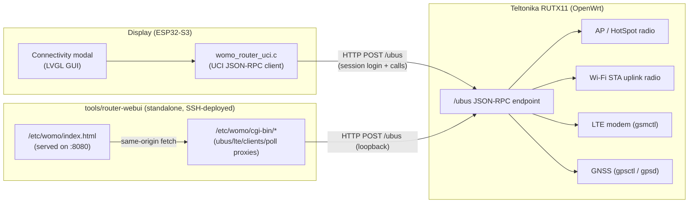
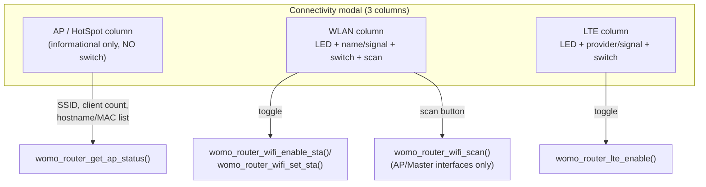

## Zweck und Rolle im Gesamtsystem

Der **Teltonika RUTX11** ist der dritte physische Knoten des WoMoHome-Fahrzeugcomputers (neben
dem Sensorboard und dem Display), aber anders als diese ist er ein kommerzieller, auf OpenWrt
basierender Router und keine Projekt-Firmware — er wird über UCI/ubus konfiguriert, nicht aus
diesem Repository gebaut. Er ist über zwei Relais mit Freilaufdiode und Nachlaufverzögerung (gemäß
RUTX11-Dokumentation) an das 12-V-Bordnetz des Fahrzeugs angeschlossen und nutzt eine dachmontierte
Teltonika-Antenne mit 2× Wi-Fi, 2× LTE und 1× GNSS-Element.

Seine Aufgaben:

- **Wi-Fi**: betreibt sowohl einen internen Access Point ("HotSpot", das lokale Netz des
  Fahrzeugs) als auch eine Wi-Fi-Client-/Station-Rolle (STA), die als Internet-Uplink genutzt wird,
  sobald ein bekanntes Netz (z. B. Campingplatz-WLAN) in Reichweite ist.
- **LTE**: stellt über eine eingelegte SIM mobilen Internetzugang bereit, mit Dual-SIM-Slot-Umschaltung.
- **GNSS**: liefert GPS-Positions-/Fix-Daten, die vom Display für die Sonnenaufgangs-/Sonnenuntergangsberechnung
  sowie standortbasiertes Wetter/Warnungen genutzt werden.
- **Hotspot**: Der AP des RUTX11 ist das *einzige* Netzwerk, dem sowohl Display als auch Sensorboard
  als Wi-Fi-Stationen beitreten; es ist das private LAN des Fahrzeugs.

Sowohl Display als auch Sensorboard treten dem RUTX11 als Wi-Fi-Stationen bei (Standard-LAN-IP
`192.168.55.1`, siehe `firmware/shared/womo_config.h`), aber **nur das Display** verwaltet den
Router: Es ist der einzige Integrationspunkt, der sich bei der UCI/ubus-API des Routers anmeldet,
Wi-Fi-/LTE-/AP-Zustand liest/steuert und sämtliche ausgehenden Internetaufrufe tätigt (Wetter,
Geocoding, Warnungen — siehe
[External Services](../integrations/external-services.md)). Die eigene Wi-Fi-Verbindung des
Sensorboards wird nur für den NTP-Abgleich und zum Bereitstellen seines eigenen lokalen
HTTP-Dashboards genutzt; es spricht nie mit der Management-API des Routers. Siehe
[System Architecture: Overview](overview.md) und [Display](display.md) dazu, wie sich das in den
Rest des Systems einfügt.

## Kommunikation: UCI JSON-RPC über HTTP, nicht RS485

`firmware/display/main/network/womo_router_uci.c` (`womo_router_uci.h`) spricht **JSON-RPC 2.0
über HTTP** mit dem `ubus`-Endpunkt des Routers (`POST http://<router-ip>/ubus`, Standard
`CONFIG_WOMO_ROUTER_IP = 192.168.55.1`). Alle Aufrufe sind synchron und hinter einem internen
Mutex serialisiert.

- **Session**: `womo_router_uci_ensure_session()` meldet sich an (`session`/`login`, Benutzername
  `admin`), um ein `ubus_rpc_session`-Token zu erhalten, das serverseitig 300 s gültig ist; der
  Client erneuert es 30 s vor Ablauf und meldet sich bei einem Berechtigungsfehler automatisch neu
  an. `womo_router_is_reachable()` prüft nur, ob dieser Login/diese Session erfolgreich ist — es
  meldet den Router als erreichbar, auch wenn der Wi-Fi-STA-Uplink selbst gerade getrennt ist oder
  sucht, da GPS-/LTE-/AP-Daten auch ohne Wi-Fi-Uplink gültig sein können.
- **Low-Level-Aufrufe**: `womo_router_uci_get/set/commit()` kapseln die UCI-ubus-Aufrufe
  `config`/`get`/`set`/`commit`; `womo_router_exec()` führt über die `file`/`exec`-ubus-Methode
  einen festen Shell-Befehl auf dem Router aus (z. B. `gsmctl`, `gpsctl`) und gibt dessen stdout
  zurück.
- **Darauf aufbauende High-Level-Abfragen/Aktionen**: `womo_router_get_wifi_status()`,
  `womo_router_get_lte_status()`, `womo_router_get_gps()`, `womo_router_get_ap_status()`,
  `womo_router_wifi_scan()`, `womo_router_wifi_set_sta()`, `womo_router_wifi_enable_sta()`,
  `womo_router_lte_enable()` und `womo_router_get_data_pass()`.
- **Polling**: Ein dedizierter `router_poll_task` in `main.c` läuft alle
  `ROUTER_POLL_INTERVAL_MS` (15 s), ruft die Wi-Fi-/LTE-/AP-Getter auf und schreibt die Ergebnisse
  in mutex-geschützte Snapshot-Globals (`s_router_wifi`, `s_router_lte`, `s_router_ap`); eine
  separate, deutlich seltenere Taktung (`ROUTER_DATAPASS_POLL_CYCLES`, etwa alle 30 min, plus
  einmal sofort nach Wiederverbindung) aktualisiert das zwischengespeicherte Datenpass-Volumen. Bei
  Wi-Fi-Verlust leert der Task den zwischengespeicherten Wi-Fi-/LTE-Zustand, damit die UI keine
  veralteten Daten zeigt, und setzt seinen Poll-Zähler zurück, damit die nächste Wiederverbindung
  schnell erkannt wird.

**GPS-, LTE- und Wi-Fi-Status werden ausdrücklich *nicht* über die Sensorboard↔Display-Verbindung
übertragen** (im Quelltext und in der Doku durchgängig als "RS485" bezeichnet, obwohl der aktuell
kompilierte Transport ESP-NOW ist — siehe [System Architecture: Overview](overview.md)). Das
periodische `ctrl`-Topic, das das Sensorboard sendet, trägt nur `pwr_on`/`radio_on`/`ac_present`;
vom Router abgeleitete Felder werden ausschließlich vom `router_poll_task` in den zusammengeführten
Snapshot des Displays geschrieben, unabhängig von der Sensorboard-Verbindung, sodass sich die
beiden Datenquellen nie gegenseitig überschreiben.
(Quelle: `firmware/display/CLAUDE.md`: *"WiFi/LTE-Zustand kommt **nicht** vom Sensorboard – Display
pollt Router direkt."* / *"GPS/LTE: Werden **nicht** über RS485 übertragen. Display pollt den
Router direkt (HTTP/SSH)."*)

## Connectivity-Modal (Display-GUI)

Das Display stellt Router-Status/-Steuerung über ein 640×420 px großes, dreispaltiges
**Connectivity-Modal** (`main/gui/womo_connectivity_modal.c`) dar: **HotSpot/AP | WLAN | LTE**,
nebeneinander.

- **WLAN- und LTE-Spalte**: Titel + eine farbige Status-LED (grün = aktiv, rot = inaktiv), der
  Verbindungsname (SSID/Provider plus Signal-%) sowie ein Schalter zum Ein-/Ausschalten dieses
  Funkmoduls. Der WLAN-Schalter steuert `womo_router_wifi_set_sta()` / `womo_router_wifi_enable_sta()`;
  der LTE-Schalter steuert `womo_router_lte_enable()`. Beide Schalter wenden nach einem Toggle eine
  45-s-Abklingzeit (`SWITCH_COOLDOWN_MS`) an, bevor der nächste Toggle akzeptiert wird, um den
  Router nicht zu überlasten, während ein Funkzustandswechsel noch nicht abgeschlossen ist. Die
  WLAN-Spalte hat außerdem eine Scan-Schaltfläche, ein Netzwerk-Dropdown und ein Passwortfeld
  (QWERTZ-Bildschirmtastatur), das erst erscheint, nachdem ein Netzwerk im Dropdown ausgewählt
  wurde; die Auswahl einer bekannten SSID füllt ein gespeichertes Passwort vorab aus.
- **AP-Spalte**: rein informativ — **sie hat keinen Schalter**. Sie zeigt die AP-SSID, die Anzahl
  der aktuell verbundenen Clients sowie eine Geräteliste (Hostname aus dem DHCP-Lease, Fallback auf
  die MAC-Adresse, falls kein Hostname bekannt ist).

### Sicherheitsinvariante: Der AP darf niemals deaktiviert werden

Die AP-Schnittstelle darf **niemals** per Software deaktiviert werden, da sie der einzige
Kommunikationsweg zwischen den ESP32-Boards (Display, Sensorboard) und dem Router ist. Deshalb hat
die AP-Spalte im Connectivity-Modal bewusst keinen Ein-/Aus-Schalter — es gibt keinen Codepfad in
`womo_connectivity_modal.c` oder `womo_router_uci.c`, der den AP deaktiviert, und auch das
eigenständige Tool `tools/router-webui` hat in `womo_router.html` ebenso keinen AP-Schalter. Das
Deaktivieren des AP würde die Verbindung des Displays/Sensorboards zur UCI-API und zum Wi-Fi-Netz
des Routers kappen und wäre vom Touchscreen aus nicht wiederherstellbar.
(Quelle: `firmware/display/CLAUDE.md`: *"AP darf **niemals** per Software deaktiviert werden, da
er der einzige Kommunikationskanal zwischen ESP32 und Router ist."*)

### Sicherheitsinvariante: Niemals das aktive Uplink-Funkmodul scannen

`womo_router_wifi_scan()` scannt nur die **AP/Master-Mode**-Schnittstellen des Routers (pro Gerät
über `iwinfo info`-Modusprüfungen ermittelt) und überspringt jede **aktiv verbundene Client-/STA-
Schnittstelle** (`device_scan_would_disrupt()`: `mode == "Client"` mit nicht-leerer, nicht-nuller
BSSID). Das Scannen eines aktiv verbundenen STA-Uplink-Funkmoduls erzwingt einen kanalübergreifenden
Hardware-Scan, der diese Verbindung einfrieren kann — dies wurde am 30.08.2026 an einem RUTX11
beobachtet, bei dem `radio0`/`wlan0` als AP und `radio1`/`wlan1` als verbundener STA-Uplink
fungierten; nur eine manuelle Netzwerk-Neuauswahl brachte den Router wieder zum Leben. Eine
STA-Schnittstelle, die noch nicht verbunden ist (z. B. `radio1` vor ihrer ersten 5-GHz-Verbindung),
ist von dieser Regel nicht betroffen und wird normal gescannt, da dies der übliche Weg ist, auf dem
ein Client-Funkmodul vor dem Verbinden Netzwerke entdeckt.
(Quelle: `firmware/display/CLAUDE.md`; `repo://firmware/display/main/network/womo_router_uci.c#L1125-L1163`)

### Bandauswahl beim Verbinden

Der RUTX11 hat zwei feste STA-Abschnitte für einen Dual-Radio-Uplink: 5-GHz-Ziele nutzen `radio1`
(unabhängig, kein Konflikt mit dem AP), während 2,4-GHz-Ziele `radio0` im kombinierten Modus mit
dem AP nutzen (beide teilen sich denselben Kanal, was vom Chip unterstützt wird).
`womo_router_wifi_set_sta()` wählt den Abschnitt automatisch anhand des Kanals des Zielnetzwerks
aus (`womo_router_channel_is_5ghz()`: Kanal ≥ 36 → 5 GHz) und deaktiviert den jeweils anderen
Abschnitt. `womo_router_wifi_scan()` scannt alle vorhandenen Wi-Fi-Geräte (beide Bänder) unter
Beachtung der oben genannten Uplink-Sicherheitsregel und dedupliziert die Ergebnisse dann nach SSID,
wobei nur der Eintrag mit dem stärksten Signal pro Netzwerk erhalten bleibt, sodass dieselbe SSID,
die auf beiden Bändern oder von mehreren Access Points beworben wird, nur einmal erscheint.

### Zugangsdatenspeicherung und UI-Zustand

Die Wi-Fi-Zugangsdaten des Routers werden im NVS des Displays zwischengespeichert (Namespace
`rtr_wifi`, bis zu 20 Einträge, Reihenfolge nach letzter Nutzung); die Auswahl eines Netzwerks aus
dem Scan-Dropdown füllt ein gespeichertes Passwort vorab aus. Getrennt davon hat die AP-Spalte eine
Schaltfläche "Configure Wi-Fi", die einen **ESP32-eigenen** Wi-Fi-Scan-/Verbindungsablauf startet
(`womo_wifi_scan_async` / `womo_wifi_connect`) — dies ist die eigene Stationsverbindung des
Displays (getrennt von den Funkmodulen des Routers), mit Zugangsdaten gespeichert unter NVS
`wifi_cfg`/`known_list` und weitergeleitet an das Sensorboard als `wifi_config`-Kommando; siehe
[Display](display.md) für diesen Ablauf.

## Das eigene router-webui-Tool (`tools/router-webui/`)

`tools/router-webui/` ist eine eigenständige Diagnose-/Steuer-Weboberfläche für den RUTX11,
unabhängig von der Display-Firmware, gedacht für die Nutzung von einem Laptop/Smartphone im eigenen
Wi-Fi des Routers. Es besteht aus:

- `womo_router.html` — einem Single-Page-Dashboard (AP-, WLAN-, LTE-, GPS-Karten mit LEDs,
  Signalbalken, Schaltern, Scan-/Verbindungsablauf, SIM-Umschaltung, Datenpass-Volumen), das direkt
  aus dem Browser per `fetch()` mit dem `/ubus`-Endpunkt des Routers kommuniziert, unter Verwendung
  desselben JSON-RPC-2.0-Session-Login-Musters wie die Display-Firmware
  (`ubusRaw`/`ensureSession`/`ubusCall`, 15 s Auto-Refresh, Session-Token 4:30 min zwischengespeichert).
  Wie das Connectivity-Modal des Displays hat es **keinen AP-Deaktivierungsschalter**.
- `deploy.sh [router-ip] [ssh-user]` — ein idempotenter, SSH-basierter Installer, der das HTML
  sowie eine Reihe kleiner CGI-Skripte und einen Hintergrund-Poller auf den Router pusht und sie in
  eine zweite `uhttpd`-Instanz auf Port 8080 einbindet.
- `undeploy.sh [router-ip] [ssh-user]` — macht alles, was `deploy.sh` installiert, vollständig
  rückgängig.

### Warum `/etc/womo/` und nicht `/www`

`deploy.sh` schreibt alles unter `/etc/womo/` statt in den normalen Web-Root des Routers. Auf dem
RUTX11 ist `/www` ein separates, **schreibgeschütztes SquashFS-Mount ohne Overlay**, sodass dort
geschriebene Dateien nicht erhalten bleiben; nur `/etc/` wird vom **JFFS2-Overlay** gesichert und
ist über Neustarts hinweg tatsächlich beschreibbar. `deploy.sh` legt deshalb `/etc/womo/` (und
`/etc/womo/cgi-bin/`) an und stellt es über eine dedizierte zweite `uhttpd`-Instanz bereit
(`uhttpd.womo`, lauscht auf `0.0.0.0:8080`, `cgi_prefix=/cgi-bin`), statt zu versuchen, Dateien zur
von `/www` gesicherten Standardinstanz auf Port 80 hinzuzufügen. Außerdem hängt es `/etc/womo/` an
`/etc/sysupgrade.conf` an, damit RutOS' "Einstellungen behalten"-Mechanismus das Verzeichnis über
Firmware-Updates (`sysupgrade`) hinweg erhält — RutOS' eingebaute Einstellungssicherung deckt nur
`/etc/config/*` und die Standard-Paketliste ab, nicht beliebig angelegte Verzeichnisse, weshalb
dieser explizite `sysupgrade.conf`-Eintrag notwendig ist.
(Quelle: `repo://tools/router-webui/deploy.sh#L1-L21`, `repo://tools/router-webui/deploy.sh#L416-L422`)

### Was `deploy.sh` installiert

| Pfad auf dem Router | Zweck |
|---|---|
| `/etc/womo/index.html` | das Dashboard-HTML, mit fest eingebackenem Admin-Passwort (`__ROUTER_PASS__`-Platzhalter wird beim Deploy per `python3 -c json.dumps(...)` ersetzt, damit Sonderzeichen korrekt maskiert werden) |
| `/etc/womo/cgi-bin/ubus` | leitet gepostete JSON-RPC-Bodies als Reverse-Proxy an das eigene `http://127.0.0.1/ubus` des Routers weiter, sodass der Browser nur same-origin mit Port 8080 spricht (CORS wird so vermieden) |
| `/etc/womo/cgi-bin/lte` | fasst `gsmctl -o/-t/-q` sowie `uci get network.mob1s1a1.disabled` in einer JSON-Antwort zusammen |
| `/etc/womo/cgi-bin/clients` | parst `iwinfo <ap-iface> assoclist` + `/tmp/dhcp.leases` zu einer JSON-Client-Liste (MAC, Hostname, IP, Signal) für die AP-Spalte |
| `/etc/womo/cgi-bin/simswitch` | löst `/usr/bin/sim_switch` aus, um in den jeweils anderen SIM-Slot zu wechseln |
| `/etc/womo/cgi-bin/datapass`, `/etc/womo/datapass.sh` | scrapen `pass.telekom.de` über die LTE-Schnittstelle (`--interface qmimux0`) nach verbleibendem/gesamtem Datenpass-Volumen; wird atomar nach `/etc/womo/datapass.json` geschrieben |
| `/etc/womo/poll.sh`, `/etc/womo/cgi-bin/poll` | sammeln AP-/Wi-Fi-/LTE-/GPS-Zustand über native CLI-Tools (`uci`, `iwinfo`, `gsmctl`, `gpsctl`/`ubus call gpsd position`) in `/etc/womo/status.json`, atomar geschrieben über eine temporäre Datei + `mv` |

Ein Cron-Job führt `poll.sh` alle 15 s aus (vier versetzte `* * * * *`-Einträge mit `sleep`) sowie
`datapass.sh` alle 30 min; `deploy.sh` hängt außerdem einen einmaligen, um 60 s verzögerten
`datapass.sh`-Aufruf an `/etc/rc.local` an, damit der Datenpass-Wert einmal nach dem Booten
aktualisiert wird, nachdem die LTE-PDP-Session/DHCP Zeit hatte hochzukommen. Das Deploy-Skript
öffnet zusätzlich den LAN-Zugriff auf TCP-Port 8080 in der Firewall (Regel `womo_webui`) und führt
nach der Installation einen End-to-End-Smoke-Test aus (HTTP-200-Prüfung, CGI-Proxy-Roundtrip,
LTE-CGI-Aufruf).

## Betriebshinweise

- Die Router-IP (`192.168.55.1`) und die Polling-Taktung des Displays sind fest in
  `firmware/shared/womo_config.h` bzw. `firmware/display/main/main.c` hinterlegt; eine Änderung der
  LAN-IP des Routers erfordert eine Anpassung der gemeinsamen Konfiguration und ein erneutes
  Flashen beider Firmware-Images.
- Da `womo_router_is_reachable()` nur den ubus-Login prüft, zeigt ein rotes
  "Router unreachable"-Badge im Connectivity-Modal des Displays zuverlässig an, dass die
  AP-/Netzwerkverbindung zum Router selbst ausgefallen ist — nicht lediglich, dass der
  Wi-Fi-/LTE-Uplink zum Internet gerade vorübergehend sucht.
- Der Verlust der Wi-Fi-Verbindung zum Router (ESP32-Seite) leert den zwischengespeicherten
  Wi-Fi-/LTE-Snapshot des Displays, damit keine veralteten Werte angezeigt werden; AP-/GPS-/
  Datenpass-Werte werden unabhängig davon aktualisiert, sobald die Verbindung zurückkehrt.

## Verwandte Seiten

- [System Architecture: Overview](overview.md) — wo der Router unter den drei physischen Knoten
  einzuordnen ist, und der Hinweis zur ESP-NOW-vs.-"RS485"-Benennung für die
  Sensorboard↔Display-Verbindung.
- [Display](display.md) — die LVGL-GUI, Connectivity-/Settings-Modale und die übergeordnete Rolle
  des Displays als einziger Internet-/Cloud-Integrationspunkt des Systems.
- [External Services](../integrations/external-services.md) — die ausgehenden HTTPS-Aufrufe
  (Wetter, Geocoding, Unwetterwarnungen), die das Display über den WAN-Uplink des Routers tätigt.
