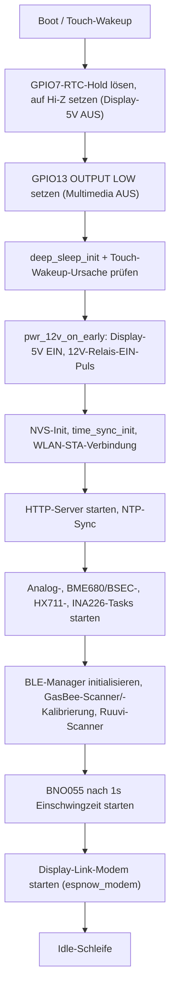

## Zweck

Das Sensorboard ist der fahrzeugseitige Datenerfassungsknoten von WoMoHome: Es liest alle
physischen Sensoren (Klima, Lage, Gewicht, Strom/Leistung, Batterie- und Tankspannungen, RTC)
ein, steuert eine kleine Gruppe von Power-Control-GPIOs (12V-Hausbatterie-Relais,
Display-Stromversorgung, Multimedia-Stromversorgung), scannt nach BLE-Peripheriegeräten
(Ruuvi-Umweltsensoren, GasBee-Gasflaschenwaagen), stellt ein lokales Web-Dashboard bereit und
leitet alles an den Display-Knoten weiter. Es läuft mit ESP-IDF v5.5.2 auf einem
ESP32-S3-WROOM-1-Modul (N16R8)
([firmware/sensorboard/README.md](repo://firmware/sensorboard/README.md#L1-L3)).

Protokolldetails für die Display-Verbindung und die BLE-Scanner werden von
[RS485 Protocol](../workflows/rs485-protocol.md) und [BLE Data Flow](../workflows/ble-data-flow.md)
verwaltet; die 12V-/Relais-Sequenzierung ist in [Power Control](../workflows/power-control.md)
beschrieben; Board-Revisionen und Schaltpläne werden in [Boards & KiCad](../hardware/boards-and-kicad.md)
behandelt; Build-/Flash-Tooling ist in [Build, Flash & Config](../operations/build-flash-config.md)
beschrieben. Diese Seite ist die Hardware-/Pin-/Sensor-Referenz pro Knoten.

## Hardware / MCU

| Komponente | Beschreibung | Bus / Pin |
|---|---|---|
| MCU | Heemol ESP32-S3 N16R8 DevKitC-1 (ESP32-S3-WROOM-1) | — |
| IMU | BNO055 — Lage, Kompass, Kalibrierung | I2C 0x28 |
| Klima (innen) | BME680 — Temperatur, Feuchte, Druck, IAQ (BSEC, 3.3V) | I2C 0x76 |
| Klima (außen) | BME280 oder BME260 — Temperatur, Feuchte, Druck, Trend (1h/3h) | I2C 0x77 |
| Gasflaschengewicht | HX711 — 2× Wägezelle (Kanal A + B) | DOUT=GPIO47, SCK=GPIO45 |
| GasBee | BLE-Gaswaage (`firmware/gasbee_nrf`), bis zu 2× (Flasche A/B) — passiver Scan, Advertising-Format v1, nur genutzt, wenn kein HX711-Modul am Kabel hängt | BLE |
| INA226 | Hauptleitungs-Strom-/Leistungsmessung (Vbus 0–36V, ±81,92 mV Shunt) | I2C 0x40 |
| Batterien | 2× ADC mit Spannungsteiler | Fahrzeug=GPIO4, Haus=GPIO5 |
| Tanks | 2× Votronic kapazitiv (0–1V) | Frisch=GPIO1 (100 L), Grau=GPIO2 (92 L) |
| RTC | PCF8523 Echtzeituhr | I2C 0x68 |
| Display-Link-Transport (alte Verkabelung) | MAX3485 RS485, Halbduplex, 57600 8N1 | TX=GPIO9, RX=GPIO10, DE=GPIO8 |
| I2C-Bus | 100 kHz, interne Pull-ups | SDA=GPIO16, SCL=GPIO15 |
| RGB-LED | WS2812 (onboard) | GPIO48 |

(Quelle: [README.md](repo://firmware/sensorboard/README.md#L9-L21), I2C-Adressen und Pins
gegen [sensor_config.h](repo://firmware/sensorboard/main/sensor_config.h#L58-L145) geprüft.)

**Transport-Hinweis:** `sensor_config.h` und `app_main.c` zeigen, dass die Display-Verbindung von
der verdrahteten RS485-UART (GPIO8/9/10) auf eine **ESP-NOW**-Funkverbindung umgestellt wurde
(`network/espnow_modem.c`, `network/espnow_transport.c`); GPIO8 wird nur noch LOW gehalten als
Altlast-Schutz für einen offenen Pin (`SENSOR_ESPNOW_DE_LEGACY_GPIO`). README.md/CLAUDE.md und
die Memory Bank beschreiben das Topic-Protokoll weiterhin unter dem historischen Namen "RS485" —
das JSON-Topic-Schema selbst ist unverändert, nur der physische Übertragungsweg unterscheidet
sich. Siehe [RS485 Protocol](../workflows/rs485-protocol.md) für die maßgebliche
Protokollbeschreibung.
(Quelle: [sensor_config.h](repo://firmware/sensorboard/main/sensor_config.h#L83-L87),
[app_main.c](repo://firmware/sensorboard/main/app_main.c#L23), [espnow_transport.h](repo://firmware/sensorboard/main/network/espnow_transport.h#L17-L48).)

## Pin-, I2C- und ADC-Referenz

Alle folgenden Werte sind aus `README.md` und `sensor_config.h` übernommen; alles, was dort
nicht ausdrücklich genannt ist, ist als **unklar** gekennzeichnet.

### I2C-Bus und Geräteadressen

| Bus-Parameter | Wert |
|---|---|
| Port | 0 |
| SDA | GPIO16 |
| SCL | GPIO15 |
| Takt | 100 kHz, interne Pull-ups aktiviert |

| Gerät | I2C-Adresse | Define |
|---|---|---|
| BNO055 (IMU) | 0x28 | — |
| BME680 (Klima innen) | 0x76 | `SENSOR_BME680_I2C_ADDR` |
| BME280/BME260 (Klima außen) | 0x77 | `SENSOR_BME280_I2C_ADDR` |
| INA226 (Strom/Leistung) | 0x40 (A0=GND, A1=GND) | `SENSOR_INA226_I2C_ADDR` |
| PCF8523 (RTC) | 0x68 | — |

(Quelle: [sensor_config.h](repo://firmware/sensorboard/main/sensor_config.h#L56-L62) für die
Bus-Parameter, [L118-L137](repo://firmware/sensorboard/main/sensor_config.h#L118-L137) für die
Adressen, [README.md](repo://firmware/sensorboard/README.md#L9-L20) für die Geräteliste.)

### Steuer-/Sense-GPIOs

| GPIO | Funktion | Richtung | Hinweise |
|---|---|---|---|
| 7 | Display-5V-Schalter | Ausgang | Neue Platinenrevision: Q5-(2N7002)-Gate-Treiber vor Q4-(AO3401A)-P-MOSFET. **HIGH = EIN**, LOW/Hi-Z = AUS. Dieses Pin direkt im alten Einzel-MOSFET-Design HIGH anzusteuern verursachte einen ~300 mA Gate-Source-Durchgangsstrom — behoben durch die Q5-Vorstufe. |
| 11 | 12V-Hausbatterie-Relais, Puls "EIN" | Ausgang | Bistabiles Relais; Ruhepegel muss LOW bleiben, ein versehentlicher Puls schaltet den 12V-Hausbus um. |
| 12 | 12V-Hausbatterie-Relais, Puls "AUS" | Ausgang | Dasselbe bistabile Relais, entgegengesetzte Spule. |
| 13 | Multimedia-Stromversorgung (N-MOSFET) | Ausgang | HIGH = EIN, LOW = AUS; beim Boot auf LOW gesetzt (kein Hardware-Pulldown). |
| 14 | 12V-Hausbatterie-Sense/Feedback | Eingang | Aktiver Pegel gemäß `SENSOR_PWR_12V_SENSE_ACTIVE_HIGH` — **unklar**, im Quellcode als TODO(hardware) markiert, bis zur Verifikation auf der Werkbank. |
| 17 | Lichtschalter-Ausgang (`SENSOR_LIGHT_GPIO`) | Ausgang | Hardware verdrahtet, Firmware-Kommandobehandlung noch nicht implementiert. |
| 18 | Pumpenschalter-Ausgang (`SENSOR_PUMP_GPIO`) | Ausgang | Hardware verdrahtet, Firmware-Kommandobehandlung noch nicht implementiert. |
| 21 | 230V-AC-Präsenzerkennung | Eingang | — |
| 6 | Touch-Wakeup (`TOUCH_PAD_NUM6`) | Eingang (RTC-fähig) | Kapazitives Touch-Pad, kein externer IC. |
| 48 | Onboard-WS2812-RGB-LED | Ausgang | Beim Boot ausdrücklich ausgeschaltet. |
| 9 / 10 / 8 | Legacy-RS485 TX / RX / DE | — | Abgelöst durch ESP-NOW; GPIO8 wird im Deep Sleep nur als Schutz gegen einen offenen Pin LOW gehalten. |
| 35, 36, 37 | **Reserviert — nicht verwenden** | — | Intern mit dem oktalen PSRAM des N16R8-Moduls verdrahtet. |

(Quelle: [README.md](repo://firmware/sensorboard/README.md#L23-L32),
[sensor_config.h](repo://firmware/sensorboard/main/sensor_config.h#L210-L263),
[sensor_config.h-Pin-Tabellenkommentar](repo://firmware/sensorboard/main/sensor_config.h#L15-L48),
[CLAUDE.md](repo://firmware/sensorboard/CLAUDE.md#L9-L18).)

### ADC-Kanäle und Spannungsteiler

| Signal | GPIO | ADC-Kanal-Define | Teiler / Bereich |
|---|---|---|---|
| Batterie 1 (Fahrzeug) | GPIO4 | `SENSOR_BATT1_ADC_CHANNEL` = 3 | 100 kΩ / 22 kΩ (Faktor 122/22), 12V → ~2,17V am ADC, BZV55B3V3-Zener-Schutz |
| Batterie 2 (Haus) | GPIO5 | `SENSOR_BATT2_ADC_CHANNEL` = 4 | gleicher Teiler wie Batterie 1 |
| Tank 1 (Frischwasser, 100 L) | GPIO1 | `SENSOR_TANK1_ADC_CHANNEL` = 0 | Votronic-kapazitiver Sensor, 0–1V direkt am ADC, 0–1000 mV = 0–100% |
| Tank 2 (Grauwasser, 92 L) | GPIO2 | `SENSOR_TANK2_ADC_CHANNEL` = 1 | gleiche Zuordnung wie Tank 1 |

Ein Messwert unter ~1V auf einem Batterie-/Tank-Kanal wird als "nicht angeschlossen"
(`nc=true`) gewertet.
(Quelle: [README.md](repo://firmware/sensorboard/README.md#L34-L38),
[sensor_config.h](repo://firmware/sensorboard/main/sensor_config.h#L142-L172).)

## Sensorik

- **BNO055 (IMU)** — Euler-Winkel, Kompasskurs, Fusions-Kalibrierstatus; Achsen-Remapping in
  `sensor_config.h` für die Einbaulage im Fahrzeug konfiguriert (Sensor-Z → logische Roll-Achse,
  Sensor-Y invertiert → logische Nick-Achse, Sensor-X → logische Kurs-Achse); Kalibrier-Offsets
  werden im NVS persistiert. Alle 5 s auf dem Topic `imu` veröffentlicht.
  (Quelle: [sensor_config.h](repo://firmware/sensorboard/main/sensor_config.h#L90-L113),
  [systemPatterns.md](repo://firmware/sensorboard/memory-bank/systemPatterns.md#L125-L130).)
- **BME680 (innen, 0x76) + BSEC** — Temperatur, Feuchte, Druck, Gaswiderstand sowie von BSEC
  abgeleitete IAQ-/eCO2-/bVOC-Werte. IAQ-Felder erscheinen erst auf der Leitung, nachdem BSEC
  nach einem Burn-in einen Wert geliefert hat (~5 min bei einem eingefahrenen Sensor, 20–30 min
  bei einem werksneuen); `iaq_acc` steigt 0→3, und der BSEC-Zustand wird ab Erreichen einer
  Genauigkeit ≥3 im NVS gesichert, damit ein Neustart nahe am letzten Kalibrierstand fortsetzt.
  Ein Platinen-Eigenerwärmungs-Offset (`SENSOR_BME680_TEMP_OFFSET_C`, Standard 4,0°C) wird vor
  der BSEC-Verarbeitung abgezogen.
  (Quelle: [README.md](repo://firmware/sensorboard/README.md#L93-L98),
  [sensor_config.h](repo://firmware/sensorboard/main/sensor_config.h#L277-L287).)
- **BME280/BME260 (außen, 0x77)** — Temperatur, Feuchte, Druck sowie ein 1h/3h-Drucktrend,
  abgeleitet aus einer im NVS gehaltenen 96-Sample-Historie (24h); kein IAQ-/BSEC-Ausgang für
  den Außensensor. Ruuvi-BLE-Tags dienen als Fallback-Datenquelle für Innen-/Außenklima, wenn
  der verdrahtete BME680/BME280 als nicht verfügbar behandelt wird.
- **HX711 (zweikanalige Wägezellen, Gasflaschen A/B)** — DOUT=GPIO47, SCK=GPIO45; Mittelung über
  3 Samples, Kalibrierung über `OFFSET`/`SCALE`-Konstanten, EMA-basierte 1h/2h-Verbrauchsraten-
  verfolgung im NVS persistiert. Das HX711-Kabelmodul hat, wenn vorhanden, für beide Kanäle immer
  Vorrang vor BLE-GasBee-Messwerten (`gas_source.c`); eine fehlende Wägezelle bei angeschlossenem
  HX711-Modul lässt sich nicht von einem Nullgewicht unterscheiden.
- **GasBee (BLE-Gaswaage, `firmware/gasbee_nrf`)** — passiver Scan-Fallback für das Gasgewicht,
  wenn kein HX711-Kabelmodul vorhanden ist, bis zu zwei Flaschen (A/B), zugeordnet per
  BLE-MAC-Adresse (vom Display konfiguriert, im NVS-Namespace `gasbee_cfg` persistiert).
  Verbindet sich nur vorübergehend zur Kalibrierung, während die GasBee an USB-Strom hängt.
- **INA226 (0x40)** — Hauptleitungs-Busspannung, Strom, Leistung und Shuntspannung;
  der Shunt-Widerstand (`SENSOR_INA226_SHUNT_MOHM`, Standard-Platzhalter 10 mΩ) muss auf den
  verbauten Shunt-Wert gesetzt werden. Alle 5 s auf dem Topic `elec` veröffentlicht; meldet
  `nc=true`, wenn das Gerät nicht auf dem Bus gefunden wird.
- **Analoge Batterie-/Tank-ADC** — Median-von-3-Abtastung, kanalweise lineare Kalibrierung
  (`SCALE`/`OFFSET_MV`), Erkennung "nicht angeschlossen" unter ~1V.
- **PCF8523 (RTC, 0x68)** — Echtzeituhr, synchronisiert per NTP nach dem WLAN-Verbindungsaufbau.

## Steuer-GPIOs & Power-Domains

Auf dem Sensorboard gibt es drei unabhängig schaltbare Stromdomänen:

1. **Display-5V** (GPIO7) — P-MOSFET Q4, angesteuert über eine N-MOSFET-Vorstufe Q5 in der
   aktuellen Platinenrevision. HIGH = EIN, LOW/Hi-Z = AUS; diese Polarität wurde gegenüber dem
   ursprünglichen Einzel-FET-Design invertiert, bei dem OUTPUT HIGH dort gefährlich war.
2. **12V-Hausbatterie-Bus** (GPIO11 "EIN" / GPIO12 "AUS") — ein bistabiles Relais, geschaltet
   durch einen 500-ms-Puls (`SENSOR_PWR_12V_PULSE_MS`), eine gemeinsame Konstante, verwendet
   beim Boot (`app_main.c`), zur Laufzeit (`espnow_modem.c`) und beim Eintritt in den Deep Sleep
   (`deep_sleep.c`). Beide Pins müssen im Ruhezustand LOW bleiben; GPIO14 meldet den gemessenen
   Busstatus zurück (`ctrl.pwr_on`), mit einem 2,5-s-Gnadenfenster
   (`SENSOR_PWR_12V_SENSE_GRACE_MS`) nach jedem Puls, während dessen statt des rohen Sense-Werts
   der kommandierte Zustand gemeldet wird, um die Einschwingzeit des Relais zu überbrücken.
3. **Multimedia-Stromversorgung** (GPIO13, N-MOSFET) — HIGH = EIN, LOW = AUS, beim Boot auf
   LOW gesetzt.


_Sensorboard-Bootsequenz aus `app_main.c`, zeigt den Power-Domain-Aufbau vor dem Start der
Sensor- und Netzwerk-Tasks._

(Quelle: [systemPatterns.md](repo://firmware/sensorboard/memory-bank/systemPatterns.md#L3-L29),
[app_main.c](repo://firmware/sensorboard/main/app_main.c#L92-L100),
[sensor_config.h](repo://firmware/sensorboard/main/sensor_config.h#L208-L263),
[techContext.md](repo://firmware/sensorboard/memory-bank/techContext.md#L30-L53).)

### Bekannte Hardware-Fehler (Zusammenfassung)

Zwei Hardwareprobleme betreffen direkt die oben genannten GPIOs; vollständige Details,
Ursachenanalyse und Behebungsstatus stehen in
[Hardware Errata & Open Decisions](../hardware/errata-and-open-decisions.md):

- **12V-Hausbatterie-Relaistreiber-Fehler:** Die J7-Treiber-FETs Q1/Q2 für "12V EIN"/"12V AUS"
  sind als P-Kanal-High-Side-Schalter (IRLML2244) bestückt statt des von den
  EBL-Steuereingängen erwarteten N-Kanal-Low-Side-Pull-to-GND, sodass das Relais unabhängig von
  Pulslänge oder Sense-Verdrahtung nicht schaltet. Als Fix ist ein formgleicher Austausch gegen
  IRLML6244 (N-Kanal) identifiziert, aber noch nicht an der Hardware verifiziert.
- **GPIO13-/GPIO17-Hardwareschaden:** Eine verpolte Verbindung am Steckverbinder J7 auf einer
  früheren Platinenrevision hat den GPIO13-(Multimedia-)Ausgangstreiber hart kurzgeschlossen und
  GPIO17 (Licht) über ein vertauschtes 12V-Steuersignal beschädigt; GPIO18 (Pumpe) hat denselben
  Vorfall überstanden. Ein Firmware-Workaround ist nicht möglich — die aktuellen
  `sensor_config.h`-Pinbelegungen gelten nur für die ersetzte, unbeschädigte Platinenrevision.

(Quelle: [progress.md](repo://firmware/sensorboard/memory-bank/progress.md#L41-L52),
[sensor_config.h](repo://firmware/sensorboard/main/sensor_config.h#L226-L245).)

## NVS-Namespaces

| Namespace | Key(s) | Inhalt |
|---|---|---|
| `bno055` | `calib`, `pr_zero` | IMU-Kalibrier-Offsets, Pressure-Zero |
| `bme680` | `press_hist` | Außendruck-Historie (96 Samples / 24h) |
| `bsec` | `state_in_<addr>_v<n>` | BSEC-IAQ-Zustand, je Sensor/Version (z. B. `state_in_76_v3`) |
| `gas_state` | `gas` | Gasverbrauch (Raten, Voll-Referenzen, letzter Wert mit Zeitstempel + Quelle zur Überbrückung von Ausfällen) |
| `tank_state` | `tank1`, `tank2` | Tank-Verbrauchsraten |
| `wifi_cfg` | `ssid`, `pass` | WLAN-STA-Zugangsdaten (RUTX11-Router) |
| `ruuvi_cfg` | `indoor_mac`, `outdoor_mac` | MAC-Filter des Ruuvi-BLE-Scanners, vom Display konfiguriert |
| `gasbee_cfg` | `bottle_a_mac`, `bottle_b_mac` | Zuordnung GasBee → Flasche (A/B), vom Display konfiguriert |

(Quelle: [README.md](repo://firmware/sensorboard/README.md#L131-L142),
[techContext.md](repo://firmware/sensorboard/memory-bank/techContext.md#L66-L77).)

## Web-Dashboard

Erreichbar unter `http://Womo-Sensor.local/`, sobald das Sensorboard dem WLAN (RUTX11-Router)
beigetreten ist, bereitgestellt von einem ESP-IDF-HTTP-Server auf Port 80 mit statischen Assets
(HTML/PNG/Favicon), geladen aus der `storage`-SPIFFS-Partition, gemountet unter `/spiffs`.

| Endpunkt | Methode | Beschreibung |
|---|---|---|
| `/` | GET | Weiterleitung auf `/dashboard.html` |
| `/dashboard.html` | GET | Vollständiges Steuer- und Sensor-Dashboard |
| `/horizon.html` | GET | Horizont-/Parkhilfe-Anzeige |
| `/api/status` | GET | Systemstatus (JSON) |
| `/api/data` | GET | Aktueller Sensor-Snapshot (JSON) |
| `/api/imu` | GET | IMU-Snapshot (JSON) |
| `/api/cmd` | POST | Steuerkommandos (JSON, gleiche `cmd`-Syntax wie bei der Display-Verbindung) |

(Quelle: [README.md](repo://firmware/sensorboard/README.md#L115-L129).)

## Code-Modulstruktur

```
main/
├── app_main.c              Startup, Task-Orchestrierung
├── sensor_config.h         Pin-Belegung, Kalibrierung, Konstanten
├── hal/
│   ├── sensor_i2c_bus      I2C-Bus-Init
│   └── deep_sleep          Touch-Wakeup, Deep Sleep
├── sensors/
│   ├── analog_sensor       ADC (Batterien, Tanks), Median-von-3-Mittelung
│   ├── bme680_sensor       BME680/BME280/BME260 + BSEC + Drucktrend
│   ├── bno055_sensor       IMU + Kalibrierung
│   ├── hx711_sensor        Wägezellen (Gas, Kabel)
│   ├── gas_source          Gasgewicht-Quellenwahl: HX711 (Vorrang) oder GasBee
│   └── ina226_sensor       INA226 Hauptleitungs-Strom-/Leistungsmessung
├── network/
│   ├── espnow_modem        JSON-Serialisierung aller Topics, Steuerlogik (Display-Verbindung)
│   ├── espnow_transport    ESP-NOW-Funkübertragung zum Display
│   ├── ble_manager         NimBLE-Stack, passiver Scan, Advertising-Dispatch
│   ├── ruuvi_ble_scanner   Ruuvi-DF5-Dekodierung (innen/außen)
│   ├── gasbee_ble_scanner  GasBee-Advertising v1 (Flasche A/B)
│   ├── gasbee_gatt_cal     GATT-Client, nur für die GasBee-Kalibrierung (USB-Modus)
│   └── wifi/
│       ├── sensor_wifi     STA-Verbindung (RUTX11), NVS-Zugangsdaten
│       └── sensor_http     HTTP-Server (Dashboard, Parkhilfe, API)
└── time/
    ├── rtc_pcf8523         RTC-Treiber (PCF8523)
    └── time_sync           NTP + RTC-Sync
```

(Quelle: [README.md](repo://firmware/sensorboard/README.md#L148-L177) Modulbaum, abgeglichen
gegen die tatsächlichen Dateien unter
[main/network](repo://firmware/sensorboard/main/network/espnow_modem.c) — das README benennt
das Display-Verbindungsmodul weiterhin `rs485_modem`/`womo_rs485`, aber der aktuelle Quellbaum
implementiert es als `espnow_modem`/`espnow_transport`.)

## Status

### Fertig (implementiert, Produktion)

| Feature | Hinweis |
|---|---|
| Topic-basiertes Display-Link-Protokoll (v2) | Round-Robin-Scheduling, ACK, Halbduplex-Timing-Semantik, übernommen aus dem ursprünglichen RS485-Design |
| BME680 (innen, 0x76) + BSEC | IAQ, eCO2, bVOC, Drucktrend |
| BME280/BME260 (außen, 0x77) | Drucktrend (1h/3h), 96-Sample-Historie |
| BNO055-IMU | Euler-Winkel, Kurs, Kalibrierstatus, NVS-Persistenz |
| HX711-Wägezellen (Gas A+B) | 3-Sample-Mittelung, EMA-Rate, NVS-Persistenz |
| INA226-Strom/Leistung | Integriert, Topic `elec` |
| Analog-ADC (Batterie + Tank) | Median-von-3, Kalibrierung, Erkennung "nicht angeschlossen" |
| 12V-Hausbatterie-Steuerung | Bistabiles Relais, Puls `SENSOR_PWR_12V_PULSE_MS` (500 ms), `ctrl.pwr_on` spiegelt den gemessenen GPIO14-Zustand — **schaltet wegen des oben genannten Hardware-Treiberfehlers das EBL-Relais noch nicht** |
| Multimedia-Steuerung | N-MOSFET auf GPIO13 |
| Display-5V-P-MOSFET | Sicherheitslogik (Hi-Z = AUS, im alten Einzel-FET-Design nie HIGH ansteuern) |
| Deep Sleep + Touch-Wakeup | GPIO6 kapazitiv, RTC-fähig |
| PCF8523-RTC | I2C 0x68, NTP-Sync nach WLAN-Verbindung |
| WLAN-STA (RUTX11) | NVS-Zugangsdaten, mDNS, Retry-Logik |
| HTTP-Web-Dashboard | `/api/*`, SPIFFS, mDNS `Womo-Sensor.local` |
| WLAN-Zugangsdaten-Anfrage über Display-Verbindung | `wifi_pass_request` → Display zeigt einen Dialog |
| Ruuvi-BLE-Scanner (innen/außen) | DF5-Dekodierung, Fallback für BME280/680, Batteriespannung |
| Ruuvi-MAC-Konfiguration über Display | `cmd:"ruuvi_config"` + Scan-Anfrage/-Antwort, NVS statt Compile-Time-Default |

(Quelle: [progress.md](repo://firmware/sensorboard/memory-bank/progress.md#L5-L25).)

### In Arbeit / Offen (in Bearbeitung / geplant)

| Feature | Status | Nächste Schritte |
|---|---|---|
| GasBee-Einrichtung (USB) + Kalibrierung über das Display | An Hardware getestet | Weitere Feldtests (zwei GasBees, Fehlerfälle) |
| Gasverbrauch über Stromausfall-Lücken (≤1 Tag) | Fertiggestellt | Übernacht-Test, Verifikation des "Gas gap …"-Logs |
| GasBee-BLE (Advertising v1, Flasche A/B) | Läuft an Hardware (Flasche A) | Paketempfangsrate pro `seq` überwachen, HX711-↔-GasBee-Quellenwechsel testen, Flasche B, LiPo-Kennlinie verifizieren, GasBee kalibrieren |
| INA226-Shunt-Kalibrierung | Hardware noch nicht installiert | Shunt messen, `SENSOR_INA226_SHUNT_MOHM` setzen |
| Original-WoMo-Tanksensoren (4-Stufen-Reed) | Planung | Pin-Konflikt: GPIO17/18 waren dafür vorgesehen, sind nun aber für Licht/Pumpe verdrahtet — neue freie Pins und ein Widerstandsnetzwerk müssen noch gewählt werden |
| Licht (GPIO17) + Pumpe (GPIO18) Steuerung | Hardware verdrahtet, Firmware ausstehend | GPIOs beim Boot und in beiden Deep-Sleep-Pfaden bereits sicher auf OUTPUT LOW initialisiert; noch fehlend: Kommandobehandlung (z. B. `light_on`/`pump_on`), Topic-Integration, Display-UI |
| Kalibrierungs-Web-UI | Konzept | NVS-Schicht + Web-Formular für HX711/Batterie/Tank |
| Merge des Web-Dashboard-Feature-Branches | Feature-Branch | Review → PR → main |
| 12V-Hausbatterie-Unterspannungsschutz | Nicht implementiert | Noch keine automatische Abschaltung bei Hausbatterie-Unterspannung; Schwellwert/Zeitfenster müssen noch definiert werden, vermutlich aufbauend auf dem vorhandenen Batterie-ADC (`analog_sensor.c`, Topic `bat`) |

(Quelle: [progress.md](repo://firmware/sensorboard/memory-bank/progress.md#L27-L39).)

## Verwandte Seiten

- [RS485 Protocol](../workflows/rs485-protocol.md) — Topic-/Kommando-Protokolldetails der Display-Verbindung
- [BLE Data Flow](../workflows/ble-data-flow.md) — Ruuvi- und GasBee-BLE-Scan-/Advertising-Ablauf
- [Power Control](../workflows/power-control.md) — 12V-Relais-, Display-Strom- und Deep-Sleep-Sequenzierung
- [Boards & KiCad](../hardware/boards-and-kicad.md) — Platinenrevisionen und Schaltpläne
- [Hardware Errata & Open Decisions](../hardware/errata-and-open-decisions.md) — vollständige Details zum Relaistreiber-Fehler und zum GPIO13/17-Schaden
- [Build, Flash & Config](../operations/build-flash-config.md) — ESP-IDF-Build-/Flash-Workflow
