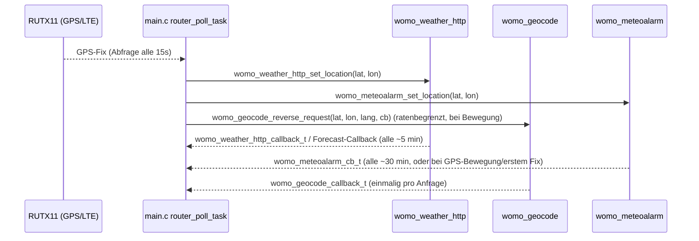

## Überblick

Die **Display-Firmware** (`firmware/display`) ist die einzige Komponente in diesem Repository, die direkt mit dem öffentlichen Internet kommuniziert. Sie führt ausgehende HTTPS-Aufrufe an drei unabhängige, unauthentifizierte Drittanbieter-APIs aus — Open-Meteo, Nominatim und Meteoalarm —, um den Hauptbildschirm mit Wetterdaten, Ortsnamen und Unwetterwarnungen anzureichern. Alle drei laufen als Hintergrund-FreeRTOS-Tasks auf dem ESP32-S3, erzeugt aus `main.c`, und alle drei betten ihren eigenen TLS-Vertrauensanker als PEM-Konstante ein, statt sich auf das ESP-IDF-Zertifikatsbündel zu verlassen.

Dies ist strikt getrennt von der Steuerebene des Teltonika-RUTX11-**Routers** (WLAN/LTE/AP/UCI-JSON-RPC), bei der es sich um lokalen LAN-HTTP-Verkehr handelt, nicht um Internet-Verkehr — siehe [Router und Konnektivität](../architecture/router-and-connectivity.md).

| Dienst | Zweck | Modul | TLS-Vertrauensanker |
|---|---|---|---|
| Open-Meteo | Aktuelles Wetter + 5-Tage-Vorhersage | `womo_weather_http` (`main/network/womo_weather_http.c/.h`) | ISRG Root X1 (`isrg_root_x1_pem.h`) |
| Nominatim (OpenStreetMap) | Reverse-Geokodierung des GPS-Fixes des Fahrzeugs zu einem Ortsnamen | `womo_geocode` (`main/network/womo_geocode.c/.h`) | ISRG Root X1 (`isrg_root_x1_pem.h`) |
| Meteoalarm | CAP-Unwetterwarnungs-Feed | `womo_meteoalarm` (`main/network/womo_meteoalarm.c/.h`) | GEANT TLS RSA 1 (`harica_root_pem.h`) |

## Gemeinsames Design: GPS-gesteuerte, Mutex-serialisierte HTTPS-Tasks

Alle drei Module hängen von einem GPS-Fix ab statt von einem festen Standort: Das Display besitzt keinen eigenen Standortsensor, daher werden GPS-Koordinaten, die durch Abfragen des Routers gewonnen werden (`router_poll_task` in `main.c`), über einen Setter (`womo_weather_http_set_location`, `womo_meteoalarm_set_location`) in jedes Modul eingespeist oder direkt an eine Einmal-Anfrage übergeben (`womo_geocode_reverse_request`). Die GPS-/LTE-Erfassung selbst ist unter [Router und Konnektivität](../architecture/router-and-connectivity.md) dokumentiert; diese Seite behandelt nur, was mit den resultierenden Koordinaten geschieht.

Da der interne SRAM des ESP32-S3 knapp wird, sobald eine TLS-Sitzung aktiv ist, serialisiert ein einziges globales Semaphor, `womo_http_mutex` (`main/network/womo_http_mutex.c/.h`), **alle** HTTPS-Anfragen in der Firmware: `esp_http_client_cleanup()` muss innerhalb des Mutex-gehaltenen Bereichs laufen, damit der TLS-Sitzungs-RAM freigegeben wird, bevor der nächste Client das Mutex erwirbt. Jedes Modul setzt `cert_pem = <embedded root>` direkt in `esp_http_client_config_t`, statt `crt_bundle_attach` zu verwenden — laut Code-Kommentaren wird damit ein Absturz (`0x4290`) umgangen und vermieden, das deutlich größere Standard-IDF-Zertifikatsbündel im RAM vorhalten zu müssen.

## Open-Meteo (`womo_weather_http`)

- **Endpunkt**: `GET https://api.open-meteo.com/v1/forecast?latitude=...&longitude=...&current=temperature_2m,weather_code,is_day,pressure_msl,relative_humidity_2m,wind_speed_10m&daily=weather_code,temperature_2m_max,temperature_2m_min,precipitation_sum,precipitation_probability_max,wind_speed_10m_max,sunshine_duration&timezone=auto&forecast_days=5` (gebaut in `weather_http_build_url`).
- **Lebenszyklus**: `womo_weather_http_start(callback, user_data)` startet einen eigenen Task (`om_task`, mit SPIRAM-gestütztem Stack), der nach dem Start 3 s wartet (Beruhigungsphase) und dann in einer Schleife läuft: abrufen → `callback` mit aktuellen Daten aufrufen und, falls verfügbar, den über `womo_weather_http_set_forecast_callback` registrierten Forecast-Callback → für das konfigurierte Intervall schlafen. Das Intervall beträgt standardmäßig 5 Minuten (`OM_DEFAULT_INTERVAL_MIN`) und ist über `CONFIG_WOMO_OWM_UPDATE_MINUTES` (Kconfig/menuconfig) überschreibbar.
- **Standortquelle**: `womo_weather_http_set_location(lat, lon)` wird aus `router_poll_task` aufgerufen, sobald ein GPS-Fix vom Router gelesen wird. Die zuletzt bekannte Position wird außerdem in NVS persistiert (Namespace `weather_gps`, Schlüssel `lat`/`lon`), geschrieben nur, wenn sich die Position um mehr als ~550 m bewegt hat (`NVS_SAVE_DELTA_DEG`), damit Wetterabfragen auch nach einem Neustart sofort fortgesetzt werden können, noch bevor ein frischer GPS-Fix vorliegt. Ist noch keine Position bekannt (kein aktuelles GPS und kein NVS-Eintrag), fragt die Abrufschleife alle 15 s ab, ohne eine Anfrage zu stellen.
- **Fehlerbehandlung**: Ein HTTP-429 (Rate-Limit) löst einen 15-minütigen Backoff aus; jeder andere Fehler (DNS noch nicht bereit, kein Internet, TLS-Fehler) löst einen 30-s-Retry aus. Der Task wird gestoppt (`womo_weather_http_stop`) und sein `weather_started`-Flag zurückgesetzt, sobald `main.c` erkennt, dass der ESP32 seine eigene WLAN-/Ethernet-Anbindung verloren hat, und wieder gestartet, sobald WLAN und NTP-Zeitsynchronisation (`womo_time_is_synced()`) beide wieder verfügbar sind — die TLS-Zertifikatsvalidierung erfordert eine annähernd korrekte Systemuhr.
- **Konsumierung**: `openweather_update_cb` in `main.c` bildet den WMO-Wettercode (`weather_code`) und das `is_day`-Flag auf das interne `womo_weather_condition_t`-Enum der UI ab und aktualisiert das Wetter-Widget des Hauptbildschirms; `forecast_update_cb` versorgt das 5-Tage-Vorhersage-Modal (`womo_forecast_modal`).

## Nominatim-Reverse-Geokodierung (`womo_geocode`)

- **Endpunkt**: `GET https://nominatim.openstreetmap.org/reverse?lat=...&lon=...&format=jsonv2&accept-language=<lang>&zoom=10` (gebaut in `geocode_build_url`), mit einem expliziten `User-Agent: WoMoHome-ESP32/1.0`-Header (Nominatims Nutzungsrichtlinie verlangt einen identifizierenden User-Agent).
- **Lebenszyklus**: Anders als die beiden anderen Dienste ist `womo_geocode` **kein** dauerhaft laufender Hintergrund-Task. `womo_geocode_reverse_request(lat, lon, accept_language, callback, user_data)` startet pro Anfrage einen kurzlebigen Einmal-Task; `womo_geocode_is_running()` verhindert überlappende Anfragen (liefert `ESP_ERR_INVALID_STATE`, falls bereits eine Anfrage läuft).
- **Auslösung und Ratenbegrenzung**: `geocode_trigger_if_needed()` in `main.c` wird bei jedem GPS-Update aufgerufen und stellt nur dann eine neue Anfrage, wenn WLAN verbunden ist, NTP-Zeit synchronisiert ist, die GPS-Koordinaten endlich/ungleich null sind, mindestens 60 s seit der letzten erfolgreichen Anfrage vergangen sind (`GEOCODE_MIN_INTERVAL_US`, nach einem Fehlschlag ein kürzeres Retry-Intervall) und sich die Position seit der letzten erfolgreichen Geokodierung über ein Mindestdelta hinaus bewegt hat. Die UI-Sprache (`de`/`en`, aus `womo_locale_get()`) wird als `accept-language` übergeben.
- **Ergebnis**: `womo_geocode_result_t` enthält einen `short_name` (Stadt/Ort/Gemeinde, optional mit Bundesland, zusammengesetzt aus Nominatims `address`-Objekt) sowie einen vollständigen `display_name`. `geocode_result_cb` in `main.c` schreibt den Kurznamen in das Standort-Label des Hauptbildschirms und in das geöffnete Forecast-Modal (falls sichtbar); bei einem Fehlschlag markiert es die letzte Anfrage als fehlgeschlagen, sodass der nächste Versuch das kürzere Retry-Intervall nutzt, statt die vollen 60 s abzuwarten.

## Meteoalarm-Unwetterwarnungs-Feed (`womo_meteoalarm`)

- **Endpunkt**: `GET https://feeds.meteoalarm.org/api/v1/warnings/for-coordinates/{lat}/{lon}` (CAP-abgeleitetes JSON), abgefragt mit auf 5 Nachkommastellen genauen Koordinaten.
- **Lebenszyklus**: `womo_meteoalarm_start(callback, user_data)` startet einen `meteoalarm`-Task mit einer langen (3-minütigen, `MA_START_DELAY_S`) Anfangsverzögerung nach dem Boot — bewusst später als Open-Meteo/Geocode —, damit sich Heap und TLS-Stack beruhigen können, bevor ein dritter gleichzeitig arbeitender TLS-Client startet. Anschließend wartet er auf eine plausible Systemuhr (Jahr ≥ 2024) und einen gültigen GPS-Fix, prüft, ob genügend zusammenhängender interner RAM frei ist (`MA_MIN_INTERNAL_FREE` / `MA_MIN_INTERNAL_LARGEST`, da das RSA-3072-GEANT-Zertifikat zur Verifikation ~13 KB zusammenhängenden internen SRAM benötigt) und verschiebt den Abruf andernfalls um 2 Minuten; danach wird abgerufen, der Callback aufgerufen und geschlafen: 30 Minuten bei Erfolg (`MA_FETCH_INTERVAL_S`), 2 Minuten nach einem TLS-/Verbindungsfehler oder 5 Minuten nach jedem anderen Fehler (`MA_RETRY_INTERVAL_S`).
- **Standortgesteuertes Nachladen**: `womo_meteoalarm_set_location(lat, lon)` weckt den Task sofort (unter Umgehung des normalen Intervalls), wenn der allererste GPS-Fix eintrifft oder wenn sich das Fahrzeug um mehr als ~5 km (`MA_LOCATION_DELTA_DEG`) von der letzten für einen erfolgreichen Abruf verwendeten Position entfernt hat.
- **Parsing und Filterung**: Das `warnings[]`-Array der Antwort wird mit cJSON geparst; im `info[]`-Array jeder Warnung wird nach einem deutschen Eintrag gesucht (`language` beginnt mit `de`), mit Rückfall auf die erste verfügbare Sprache. Schweregrade werden aus dem CAP-Vokabular (`Minor`/`Moderate`/`Severe`/`Extreme`) auf `womo_warn_severity_t` abgebildet; **`Minor` und unerkannte Schweregrade werden verworfen**, sodass nur `Moderate` und höher (Stufe 2/Orange und Stufe 3/Rot) die UI erreichen. Bis zu `WOMO_METEOALARM_MAX_WARNINGS` (8) Warnungen werden vorgehalten, jeweils mit Ereignis, Überschrift, Region (`areaDesc`, mit mehreren Fallback-Suchpfaden in der CAP-Struktur) und einem formatierten, aus RFC 3339/ISO 8601 geparsten Ablaufzeitstempel.
- **Konsumierung und Auto-Popup**: `meteoalarm_update_cb` in `main.c` aktualisiert das Warn-Badge des Wetter-Widgets (`womo_weather_set_warnings`) sowie das Forecast-Modal, falls es geöffnet ist. Ein **automatisches Warn-Popup** (`meteoalarm_popup_open()`) wird nur geöffnet, wenn seit dem vorherigen Abruf neue Warnungen aufgetreten sind oder sich der Schweregrad erhöht hat (nicht lediglich, wenn Warnungen verschwinden oder gleich bleiben), um Popup-Spam bei jeder 30-minütigen Abfrage zu vermeiden.
- **Lebenszyklus-Kopplung**: Wie bei Open-Meteo wird der Task gestoppt und sein `meteoalarm_started`-Flag zurückgesetzt, wenn die eigene WLAN-Anbindung des ESP32 abbricht, und wieder gestartet, sobald WLAN und NTP-Synchronisation wieder verfügbar sind.

## Eingebettete TLS-Root-Zertifikate

Beide eingebetteten Zertifikatsdateien sind bewusst ausgewählte **Zwischen-/Issuing-CAs statt ultimativer selbstsignierter Roots**, gewählt, um die Verifikationskette zu verkürzen und die RAM-/CPU-Kosten der TLS-Verifikation auf dem ESP32-S3 zu reduzieren:

- **`isrg_root_x1_pem.h`** — ISRG Root X1 (Let's Encrypt), RSA, gültig bis 2035. Verwendet für Leaf-Zertifikate im Stil von `geocoding-api.open-meteo.com` sowie `api.open-meteo.com` / `nominatim.openstreetmap.org` (Kette: ISRG Root X1 → R10/R11/R12 → Leaf). Wird sowohl von `womo_weather_http` als auch von `womo_geocode` gemeinsam genutzt.
- **`harica_root_pem.h`** — trotz des Dateinamens und des C-Bezeichners (`harica_root_pem`) handelt es sich bei dem eingebetteten Zertifikat um **GEANT TLS RSA 1**, die Zwischen-CA, die das Leaf-Zertifikat von `*.meteoalarm.org` direkt ausstellt (ausgestellt von HARICA TLS RSA Root CA 2021, RSA 3072-Bit, gültig Januar 2025–Dezember 2039). Es wird anstelle des HARICA-Roots selbst als Vertrauensanker verwendet, weil: (1) der HARICA-Root in älteren ESP-IDF-Zertifikatsbündeln fehlt, (2) GEANT der direkte Aussteller des Leafs ist, was eine Kette mit nur einem Hop ergibt, und (3) die RSA-3072-Verifikation weniger internen Heap benötigt als der RSA-4096-HARICA-Root. Dies ist das einzige Nicht-ISRG-Zertifikat in der Firmware und der Grund, warum `womo_meteoalarm` vor dem Abruf eine eigene, größere Wächterprüfung für den internen Heap mitführt (siehe oben).

Beide Header deklarieren das PEM als `static const char ...[]` und werden direkt in `esp_http_client_config_t.cert_pem` übergeben, womit `crt_bundle_attach` für alle drei Dienste vollständig umgangen wird.

## Keine openHAB- oder sonstige Smart-Home-Hub-Integration

**Es gibt in diesem gesamten Repository keine openHAB-Integration** — keine Items, Things, MQTT-Binding, REST-API-Binding oder einen anderen Client für einen Smart-Home-Broker, weder im Quellcode noch in der Konfiguration oder Dokumentation. Eine repositoriumsweite Suche nach "openHAB" liefert nur die eigenen Planungs-/Anweisungsmetadaten des Wikis (die openHAB-Integration als einen angestrebten Dokumentationsschwerpunkt aufführen) sowie den Disclaimer dieser Seite selbst; eine entsprechende Implementierung existiert nicht. Die ausgehende Internet-Konnektivität in dieser Codebasis beschränkt sich auf die drei oben dokumentierten, schreibgeschützten, unauthentifizierten HTTP(S)-API-Konsumenten (Open-Meteo, Nominatim, Meteoalarm); nichts in der Firmware veröffentlicht Sensordaten an openHAB oder einen vergleichbaren Hub oder nimmt Befehle von dort entgegen. Wird gefragt, ob openHAB (oder eine MQTT-/REST-Automatisierungs-Hub-Integration im Allgemeinen) existiert, lautet die korrekte Antwort: **nicht implementiert, nur angestrebt/aspirational** — es sollte kein openHAB-Datenmodell, keine Item-Struktur und keine Thing-Konfiguration beschrieben werden, da im Code nichts dergleichen existiert.

## Website: Netlify Function als eigenständiger Cloud-Endpunkt (zur Abgrenzung)

Die separate Marketing-/Doku-Website (`website/`, siehe [Marketing-/Doku-Website (Astro)](../architecture/website.md)) betreibt mit `website/netlify/functions/counter.mjs` eine einzige, kleine serverseitige Netlify Function (v2), erreichbar unter `/api/counter`, die bei jedem `POST`-Aufruf über `@netlify/blobs` (`getStore({ name: 'counter', consistency: 'strong' })`) einen reinen Seitenaufrufzähler inkrementiert und zurückgibt. Dabei handelt es sich um eine Cloud-Integration der Website mit der Netlify-Blobs-Plattform selbst, nicht um eine Internet-Integration der Fahrzeug-Firmware: Sie läuft serverseitig im Netlify-Hosting der Website, ist vollständig unabhängig von Display, Router und Sensorboard und speichert ausschließlich eine Gesamtzahl ohne IP-Adresse, Zeitstempel oder User-Agent. Details zu Aufbau, Aufrufkette und Datenschutzimplikationen dieser Funktion sind in [Marketing-/Doku-Website (Astro)](../architecture/website.md) beschrieben; sie wird hier nur erwähnt, um sie klar von den drei oben dokumentierten Firmware-Internet-Integrationen abzugrenzen.
