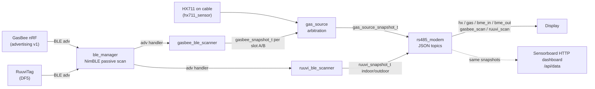

## Überblick

Zwei Arten batteriebetriebener BLE-Peripheriegeräte speisen Sensordaten in das
Sensorboard ein – ausschließlich über **passive Advertising-Scans**, es wird
für die normale Datenaufnahme keine GATT-Verbindung verwendet:

- **GasBee** (`firmware/gasbee_nrf`, Seeed XIAO nRF52840) — eine
  Gasflaschenwaage, die Bruttogewicht, Akkuspannung und Statusflags meldet.
- **RuuviTag** (Stock-DF5-Firmware) — Klimasensoren, die als Fallback für
  Innen-/Außentemperatur, Luftfeuchtigkeit und -druck dienen, wenn die
  verkabelten BME680/BME280-Sensoren nicht verfügbar sind.

Beide werden von dedizierten Modulen dekodiert, die bei einem einzigen,
gemeinsam genutzten NimBLE-Central-Stack (`ble_manager`) in der
Sensorboard-Firmware (`firmware/sensorboard`) registriert sind. Diese Seite
dokumentiert die beiden Advertising-Payload-Formate, die Scan-/Dekodier-Pipeline,
die Gasquellen-Arbitrierung zwischen verkabeltem HX711 und GasBee-BLE sowie
die Weiterleitung der resultierenden Werte über RS485 an das Display. Für den
Hardware-/Firmware-Kontext der Knoten selbst siehe
[BLE Sensor Nodes](../architecture/ble-sensor-nodes.md); für die
Gesamtarchitektur des Sensorboards siehe
[Sensorboard](../architecture/sensorboard.md); für Kalibrierverfahren siehe
[Gas Calibration](../workflows/gas-calibration.md); für das RS485-Topic-Protokoll
im Allgemeinen siehe [RS485 Protocol](../workflows/rs485-protocol.md).

## GasBee-Advertising-Format v1

Das maßgebliche Byte-Layout ist in `firmware/gasbee_nrf` definiert und wird in
`firmware/sensorboard` gespiegelt. Der GasBee bewirbt drei AD-Elemente —
Flags (`0x06`), Complete Local Name `"GasBee"` sowie Manufacturer Specific
Data für Company-ID `0xFFFF` (eine von der Bluetooth-SIG für Test-/interne
Nutzung reservierte ID) — insgesamt 22 der 31 verfügbaren Advertising-Bytes,
sodass keine Scan-Response nötig ist. Die 7 Byte lange Payload nach der
Company-ID ist:

| Byte | Typ | Feld | Invalid-Markierung |
|---|---|---|---|
| 0 | uint8 | Format-Version = 1 | – |
| 1–2 | int16 LE | Brutto-Waagegewicht in 10-g-Einheiten, **ohne Tara** | `0x8000` |
| 3–4 | uint16 LE | Akkuspannung in mV | `0xFFFF` |
| 5 | uint8 | Sequenzzähler, +1 pro Messzyklus (alle 10 Pakete eines Bursts teilen sich denselben Wert) | – |
| 6 | uint8 | Flags: Bit 0 = HX711 ok, Bit 1 = lädt (BQ25101 `~CHG`), Bit 2 = kalibriert (Offset/Scale im eigenen NVS des GasBee vorhanden), Bit 3 = Konfigurationsmodus (USB angeschlossen, Kalibrierung möglich), Bits 4–7 = reserviert/0 | – |

Es existieren keine weiteren Felder in diesem Format — es dürfen keine
zusätzlichen Bytes angenommen werden (z. B. gibt es kein Nettogewicht, keinen
Füllstand in Prozent und keinen Akku-Prozentwert in der Funk-Payload; all das
wird nachgelagert berechnet). Der GasBee misst alle
`CONFIG_GASBEE_MEASURE_INTERVAL_S` (Standard 300 s, 60 s im Testmodus) und
sendet dann einen Burst aus 10 Advertising-Paketen im Abstand von 1 s, die
alle dieselbe Sequenznummer tragen, gefolgt von Funkstille bis zum nächsten
Zyklus. Bei anliegender USB-Spannung wechselt der GasBee binnen 2 s in den
Konfigurationsmodus: Er sendet dann kontinuierlich einmal pro Sekunde, misst
alle 5 s, setzt Flag-Bit 3 und wird für Kalibrierbefehle verbindbar
(repo://firmware/gasbee_nrf/README.md#L49-L71). Da die GasBee-Adresse
random-static, aber fest ist, werden mehrere GasBees ausschließlich über die
MAC-Adresse unterschieden, die das Display den Flaschen-Slots A/B zuordnet.

## Ruuvi Data Format 5 (zum Kontext)

Der `ruuvi_ble_scanner.c` des Sensorboards dekodiert das Stock-Ruuvi-DF5-Format
("RAWv2") der Manufacturer Specific Data (Company-ID `0x0499`,
Data-Format-Byte `0x05`): Big-Endian-Temperatur (×0,005 °C), Luftfeuchtigkeit
(×0,0025 %RH), Luftdruck (+50000 Pa, /100), Beschleunigung (wird nicht
ausgewertet), ein 11-Bit-Akkuspannungsfeld (+1600 mV Offset, `0x7FF` = ungültig),
das mit der Sendeleistung gepackt ist, sowie ein Bewegungs-/Messsequenz-Tail,
der nicht ausgewertet wird
(repo://firmware/sensorboard/main/network/ruuvi_ble_scanner.c#L19-L29).
Ruuvi-Tags werden ausschließlich über einen MAC-Adressfilter dem
Innen-/Außen-Slot zugeordnet, der vom Display über `cmd:"ruuvi_config"`
konfiguriert und im NVS-Namespace `ruuvi_cfg` persistiert wird; eine leere MAC
deaktiviert einen Slot, sodass kein beliebiger Tag akzeptiert wird.
Ruuvi-Werte erscheinen in den `bme_in`/`bme_out`-RS485-Topics nur als
*Fallback*, wenn der entsprechende verkabelte BME680-/BME280-/BME260-Sensor
fehlt — diese Seite konzentriert sich auf den GasBee-Gewichtspfad, da dort die
Arbitrierung zwischen HX711 und BLE greift.

## Scan- und Dekodier-Pipeline auf dem Sensorboard

`ble_manager` (`firmware/sensorboard/main/network/ble_manager.c`) ist der
alleinige Eigentümer des NimBLE-Stacks: Er initialisiert NimBLE genau einmal,
startet einen **passiven** Scan mit `filter_duplicates = 0` (damit die
periodischen Re-Advertisements von Ruuvi/GasBee nicht unterdrückt werden) und
leitet jedes `BLE_GAP_EVENT_DISC` an bis zu vier registrierte
Advertisement-Handler weiter. Er besitzt außerdem den einzig erlaubten
GATT-Verbindungspfad (`ble_manager_connect`), der ausschließlich für die
GasBee-Kalibrierung genutzt wird (siehe unten), und startet den Scan nach
jedem Verbindungsauf-/-abbau automatisch neu.

`gasbee_ble_scanner.c` registriert sich als einer dieser Handler. Für jedes
Advertisement:

1. Prüft er, ob der Complete Local Name `"GasBee"` lautet und die
   Manufacturer Data die Company-ID `0xFFFF` mit Format-Version 1 trägt; jede
   andere Version wird verworfen.
2. Gleicht er die BLE-Adresse des Senders mit einem von zwei konfigurierten
   MAC-Filtern (Flasche A / Flasche B) ab, die aus dem NVS geladen werden
   (`gasbee_cfg`: `bottle_a_mac`, `bottle_b_mac`) und zur Laufzeit über den
   RS485-Befehl `cmd:"gasbee_config"` gesetzt werden können. Eine leere MAC
   deaktiviert den jeweiligen Slot.
3. Dedupliziert er den 10-Paket-Burst: Nur das erste Paket einer *neuen*
   Sequenznummer wird ausgewertet (jede von der zuletzt gesehenen
   abweichende `seq` zählt als neu, was auch robust gegenüber einem
   GasBee-Neustart oder dem 255→0-Überlauf macht).
4. Konvertiert er Gewichts-/Akkufelder in ein `gasbee_snapshot_t` pro Slot und
   erfasst dabei `weight_valid` (Flag-Bit 0 / nicht `0x8000`),
   `battery_valid` (nicht `0xFFFF`), `battery_pct` (über
   `gasbee_battery_pct()`, eine LiPo-Entladekurven-Lookup-Tabelle
   `SENSOR_GASBEE_LIPO_CURVE`), `charging`, `calibrated`, `config_mode`
   sowie den Empfangszeitstempel.

Unabhängig vom MAC-Filter pflegt `gasbee_ble_scanner.c` zusätzlich eine
ungefilterte **Scan-Liste** jedes in Reichweite gesehenen GasBee
(`gasbee_scan_entry_t`), die das Display über `cmd:"gasbee_scan_request"`
abfragt, um eine UI zur Zuordnung von Flasche A/B anzubieten; `cfg_only`
beschränkt diese Liste auf GasBees, die sich gerade im USB-Konfigurationsmodus
befinden, damit nicht zugehörige GasBees in Reichweite nicht mit angeboten
werden.

Tara, Nettogewicht, Füllstand und Akku-Prozentwert werden *nicht* auf dem
GasBee selbst aus dem Advertising-Pfad berechnet — das Sensorboard berechnet
sie, genauso wie beim verkabelten HX711, damit beide Quellen eine einzige
Gasberechnung teilen.

## GATT dient ausschließlich der Kalibrierung, nie der normalen Datenaufnahme

Der GasBee bietet außerdem einen GATT-Dienst
(`4a5b6c7d-8e9f-0a1b-2c3d-4e5f60718293`) zur Kompatibilität mit anderen
Clients wie etwa Smartphone-Apps an, und das Sensorboard nutzt ihn für genau
einen Zweck: das Schreiben von Kalibrierbefehlen (Nullpunkt `0x2B11`,
Referenzgewicht `0x2B12`, rohe Offset-/Scale-Werte `0x2B13`) sowie den
Tara-Befehl (`0x2B10`), wenn ein GasBee per USB angeschlossen und im
Konfigurationsmodus ist. Dies übernimmt `gasbee_gatt_cal.c`, das sich mit
einer bestimmten, aus der Scan-Liste entnommenen MAC verbindet, das
betreffende Characteristic schreibt und sofort wieder trennt
(`SENSOR_GASBEE_CAL_TIMEOUT_MS` begrenzt den Vorgang). Solange eine
GATT-Verbindung besteht, sendet der GasBee keine Advertising-Bursts, sodass
das Sensorboard (und jeder andere Scanner) bis zum Verbindungsende keine
neuen Gewichtswerte erhält. Die gewöhnliche Aufnahme von Gewicht/Akku/Status
nutzt niemals GATT.

## Gasquellen-Arbitrierung: Das HX711-Kabel hat Vorrang vor GasBee-BLE

`sensors/gas_source.c` ist der einzige Arbitrierungspunkt, der von jedem
Gas-Publisher (`hx`-Topic, `gas`-Topic und dem HTTP-Dashboard-Snapshot)
genutzt wird. Bei jedem Aufruf wird die Quelle vollständig neu bewertet:

1. **Verkabeltes HX711 vorhanden** (`hx711_app_get_snapshot()` liefert
   `ESP_OK` und mindestens ein Kanal, A oder B, ist gültig) → das HX711
   gewinnt bedingungslos und liefert beide Kanäle A und B. GasBee wird in
   diesem Fall nicht einmal konsultiert.
2. **Andernfalls** wird jeder konfigurierte GasBee-Slot (A, B) über
   `gasbee_ble_scanner_get()` geprüft: Ein Slot gilt nur als nutzbar, wenn
   jemals ein gültiges Paket empfangen wurde (`valid == true`) *und* die
   Zeit seit der letzten neuen Sequenznummer innerhalb von
   `SENSOR_GASBEE_STALE_MS` liegt (zwei Messzyklen plus Burst-Fenster). Ist
   der Slot nutzbar, liefert dessen Gewicht Kanal A oder B.
3. **Andernfalls** (weder HX711 noch ein frischer GasBee) ist die Quelle
   `none` und beide Kanäle sind ungültig — über RS485 als `nc` dargestellt.

Dieser Vorrang von HX711 vor GasBee ist eine **bedingungslose, nicht
konfigurierbare** Invariante: Die Anwesenheit des verkabelten HX711-Moduls
(erkannt daran, dass dessen DOUT-Pull-up antwortet statt in ein Timeout zu
laufen) überstimmt stets die GasBee-BLE-Daten, selbst wenn ein GasBee in
Reichweite und aktueller ist. Mischbetrieb — ein HX711-Modul ist vorhanden,
aber eine Wägezelle ist physisch getrennt — ist ausdrücklich *keine*
unterstützte Konfiguration; die Firmware kann in diesem Fall eine fehlende
Wägezelle nicht von einer legitim leeren/Null-Messung unterscheiden
(repo://firmware/sensorboard/main/sensors/gas_source.h#L14-L21). In der
Praxis hat ein Board entweder die vollständige verkabelte HX711-Waage oder
verlässt sich vollständig auf GasBees.

Eine GasBee-Messung wird von der Arbitrierungsschicht zusätzlich als
ungültig behandelt, wenn der GasBee selbst **nicht kalibriert** ist
(Flag-Bit 2 = 0): `gas_source.c` erzwingt `valid = false`, sobald
`weight_valid && calibrated` nicht gemeinsam erfüllt sind, da ein
unkalibriertes Rohgewicht keine aussagekräftige Gasmessung ist
(repo://firmware/sensorboard/main/sensors/gas_source.c#L45-L47). Ein Wechsel
der aktiven Quelle zwischen HX711 und GasBee (in beide Richtungen) setzt die
Verbrauchsraten-Basis (`rate1h`/`rate2h`) in `rs485_modem` zurück, da ein
roher Sprung zwischen zwei physisch unterschiedlichen Waagen sonst
fälschlich als Verbrauchsspitze oder -sprung registriert würde.

## Die Unterscheidung „nc" vs. „leer"

Die Felder `nc_a`/`nc_b` des `gas`-RS485-Topics und der Zustand „leere
Flasche" sind **zwei unterschiedliche Zustände, die nicht verwechselt werden
dürfen**:

- **`nc` ("not connected" — kein verwertbarer Wert vorhanden)** bedeutet,
  dass die Arbitrierungsschicht für diesen Kanal nichts Vertrauenswürdiges zu
  melden hat: veraltete oder fehlende GasBee-Daten, das eigene
  HX711-Fehler-Flag des GasBee (Bit 0 = 0) oder ein unkalibrierter GasBee.
  Bei einem **verkabelten** HX711 wird auch ein Messwert unterhalb der
  Leer-Flaschen-Schwelle (`SENSOR_GAS_NO_BOTTLE_THRESHOLD_KG`, 1 kg) als `nc`
  gemeldet, nicht als leer — denn bei einer über Kabel angeschlossenen
  Wägezelle lässt sich eine getrennte/fehlende Verbindung nicht von einer
  tatsächlich unbelasteten Waage unterscheiden, weshalb die Firmware
  konservativ von „unbekannt" statt „leer" ausgeht.
- **`leer` (leere Flasche)** bedeutet, dass ein *gültiger* Messwert unterhalb
  von `SENSOR_GAS_NO_BOTTLE_THRESHOLD_KG` empfangen wurde. Dieser Zustand ist
  nur über den **GasBee-BLE**-Pfad erreichbar, bei dem ein unterhalb der
  Schwelle liegender, aber gültiger Messwert eindeutig „keine Flasche/leere
  Flasche auf der Waage" bedeutet (es gibt keine entsprechende
  Kabeltrenn-Mehrdeutigkeit bei einer BLE-Messung, die ansonsten als gültig
  und kalibriert markiert ist). Eine leere Flasche wird als `pct_a`/`pct_b`
  = 0 gemeldet und löst den Gas-Leer-Alarm des Displays aus. Ein
  leerer/unterschwelliger Messwert wird nie als aktive Flasche ausgewählt
  und nie als neuer Referenzwert für eine volle Flasche übernommen
  (repo://firmware/sensorboard/main/network/espnow_modem.c#L978-L1009).

Kurz gesagt: `nc` heißt „ich weiß es nicht", `leer` heißt „ich weiß es, und
es ist null". Eine Vermischung der beiden würde entweder einen berechtigten
Leer-Flaschen-Alarm unterdrücken (indem `nc` gemeldet wird) oder einen
falschen Alarm bei einem getrennten verkabelten Sensor auslösen (indem
`leer` gemeldet wird).

## Weiterleitung: RS485-Topics zum Display

`network/rs485_modem.c` (die JSON-/Topic-Serialisierungsschicht, die in
[RS485 Protocol](../workflows/rs485-protocol.md) ausführlich dokumentiert
ist) ruft bei jedem Round-Robin-Durchlauf `gas_source_get_snapshot()` und die
Ruuvi-Getter auf und wandelt sie in CRLF-terminierte ASCII-JSON-Zeilen über
die RS485-Strecke um (MAX3485, 57600 8N1). Die relevanten Topics:

| Topic | Intervall | Gas-/BLE-relevante Felder |
|---|---|---|
| `hx` | 10 s | `src` (`hx`/`ble`/`none`), `a`, `b` (kg), `sum`, `nc`, `ts`; bei `src:"ble"` zusätzlich pro Flasche `batt_a_mv`/`batt_a_pct`, `chg_a`, `cal_a`, `cfg_a` (nur während dieser GasBee an USB hängt), gespiegelt für `_b` |
| `gas` | 10 s | `src`, `active`, `net`, `rate1h`, `rate2h`, `rest_h`, `net_a`, `net_b`, `cap_kg`, `pct`, `pct_a`, `pct_b` (hier stecken `nc_a`/`nc_b` und die 0-%-Leer-Flaschen-Anzeige) |
| `bme_in` / `bme_out` | 15 s | `chip` meldet `"ruuvi"`, wenn auf einen Ruuvi-Tag zurückgegriffen wird; fügt in diesem Fall `batt_mv` hinzu |
| `gasbee_scan` | auf Anfrage (`cmd:"gasbee_scan_request"`) | ein Frame pro gesehenem GasBee: `mac`, `rssi`, `weight_kg`, `batt_mv`, `batt_pct`, `chg`, `cal`, `cfg`, `bee_seq`, `age_s` — wird von der Flaschen-Zuordnungs-UI des Displays genutzt, unabhängig vom konfigurierten A/B-Filter |
| `ruuvi_scan` | auf Anfrage (`cmd:"ruuvi_scan_request"`) | ein Frame pro gesehenem Ruuvi-Tag, analoger Zweck für die Zuordnung von Klimasensoren |
| `gasbee_cal_result` | nach `gasbee_cal` | Ergebnis eines GATT-Kalibrierschreibvorgangs (`step`, `ok`, `err`, `msg`) |

Dieselben Snapshots aus `gas_source_get_snapshot()`/Ruuvi backen auch die
HTTP-Dashboard-Endpunkte des Sensorboards selbst (`/api/data`,
`/dashboard.html`) unter `firmware/sensorboard/main/network/wifi/sensor_http`,
sodass die RS485-Strecke zum Display und das lokale HTTP-Dashboard die
**einzigen beiden Konsumenten** dieser BLE-abgeleiteten Sensordaten im
gesamten Repository sind.

## Kein Home-Automation-Broker konsumiert diese Daten

Es gibt **keine openHAB-Integration, keinen MQTT-Broker und keinen anderen
Home-Automation-Hub** in diesem Repository, der GasBee- oder Ruuvi-Werte
abonniert. Eine repositoryweite Suche nach solchen Integrationen fördert nur
aspirative Dokumentationshinweise zutage, aber niemals eine Implementierung
— Items, Things, MQTT-Bindings oder REST-Automation-Hub-Clients existieren
weder im Quellcode noch in der Konfiguration oder im Build-Output (siehe
[External Services](../integrations/external-services.md) für die
vollständige Bestandsaufnahme der ausgehenden Netzwerkintegrationen dieses
Repositorys). Wird gefragt, ob BLE-Sensordaten gegenüber openHAB oder einem
ähnlichen Hub exponiert werden, lautet die korrekte Antwort, dass dies
**nicht implementiert** ist — jede derartige Zuordnung wäre spekulativ und
keine Beschreibung vorhandenen Codes. Die RS485-Strecke zum Display und das
eigene HTTP-Dashboard des Sensorboards sind die gesamte Konsumentenmenge für
diesen Datenfluss.

## Konfigurationsübersicht

| Was | Mechanismus | Persistenz |
|---|---|---|
| GasBee-Flasche-A/B-MAC-Zuordnung | RS485 `cmd:"gasbee_config"` (`bottle_a_mac`, `bottle_b_mac`) | NVS-Namespace `gasbee_cfg` |
| Ruuvi-Innen-/Außen-MAC-Zuordnung | RS485 `cmd:"ruuvi_config"` (`indoor_mac`, `outdoor_mac`) | NVS-Namespace `ruuvi_cfg` |
| GasBee-Kalibrierung (Null/Referenz) | RS485 `cmd:"gasbee_cal"` Schritte `zero`/`ref`, geleitet über `gasbee_gatt_cal.c` über eine temporäre GATT-Verbindung | eigenes On-Device-NVS des GasBee (`gasbee/offset`, `gasbee/scale`), nicht das des Sensorboards |
| Leer-Flaschen-Schwelle | `SENSOR_GAS_NO_BOTTLE_THRESHOLD_KG` (1 kg) | Compile-Time-Konstante in `sensor_config.h` |
| GasBee-Veraltungsfenster | `SENSOR_GASBEE_STALE_MS` (≈ 2 Messzyklen + Burst-Fenster) | Compile-Time-Konstante |
| BLE-Scan-Parameter | `SENSOR_BLE_SCAN_ITVL` / `SENSOR_BLE_SCAN_WINDOW`, passiv, `filter_duplicates = 0` | Compile-Time-Konstante |

Eine leere MAC-Zeichenkette deaktiviert den jeweiligen Slot vollständig,
sowohl für GasBee als auch für Ruuvi — es ist keine Standard- oder
Fallback-MAC einkompiliert; die Zuordnung erfolgt stets explizit über den
Einrichtungsablauf des Displays.
