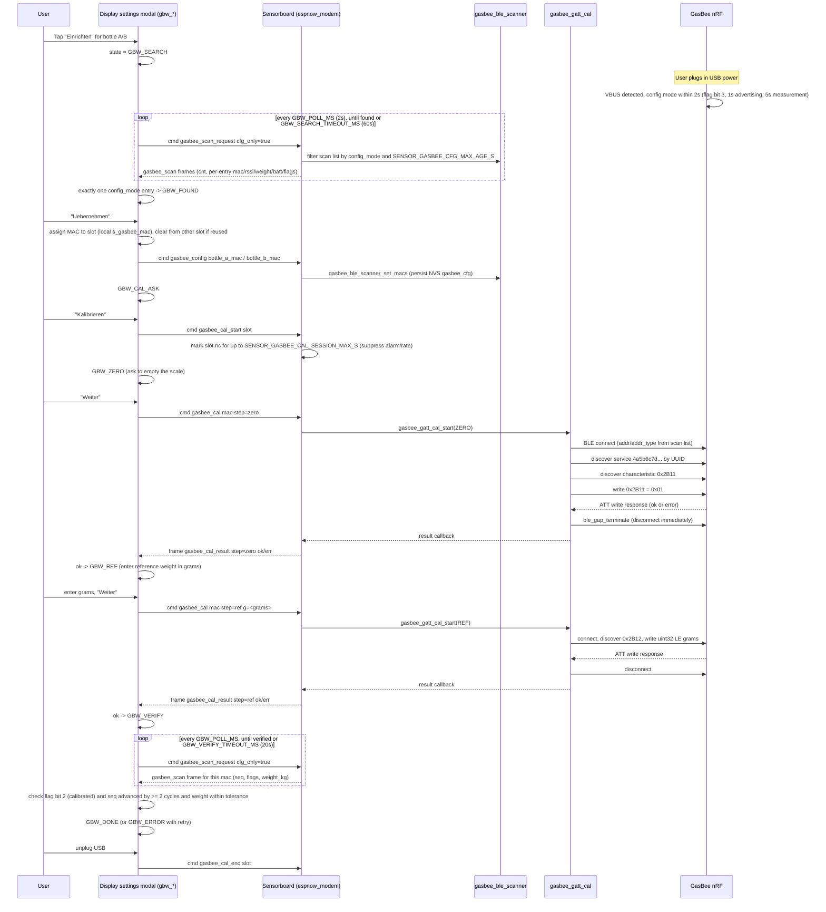

## Überblick

GasBee-Gasflaschenwaagen (`firmware/gasbee_nrf`) werden im Normalfall **passiv**
ausgelesen: Das NimBLE-Central des Sensorboards scannt deren Advertising-Bursts
und verbindet sich niemals (siehe [BLE-Datenfluss](ble-data-flow.md) und
[BLE-Sensorknoten](../architecture/ble-sensor-nodes.md)). Die Zuordnung eines
GasBee zu Flaschenplatz A/B sowie die Kalibrierung seines Nullpunkts und
Referenzgewichts ist die eine Ausnahme: Dafür ist eine **kurzlebige
GATT-Verbindung** erforderlich, und diese Verbindung ist nur möglich, solange
der GasBee über USB mit Strom versorgt wird und sich dadurch im
*Konfigurationsmodus* befindet. Diese Seite beschreibt den geführten
"Einrichten"-Assistenten, der diesen einmaligen, vom Nutzer angestoßenen
Ablauf über drei Komponenten hinweg steuert — die Settings-Modal-GUI des
Displays, die JSON-Kommando-/Topic-Verbindung zwischen Display und
Sensorboard (in dieser Codebasis historisch "RS485" genannt) sowie die
BLE-Advertising-/GATT-Schnittstellen des GasBee — und der strikt von dem
immer aktiven Passiv-Scan-Datenpfad des Normalbetriebs getrennt ist.

**Die beiden BLE-Pfade nicht vermischen**: Das reguläre Auslesen von
Gewicht/Batterie/Status erfolgt rein über Advertising, ohne Verbindung, und
läuft kontinuierlich; die Kalibrierung ist eine einzelne, kurzlebige
GATT-Verbindung, die nur aus diesem Assistenten heraus angestoßen wird, nur
solange USB-Strom den GasBee in den Konfigurationsmodus zwingt, und die nach
jedem Schreibvorgang sofort wieder abgebaut wird.

## Beteiligte

- **Display-GUI** — `womo_settings_modal.c`, Tab "RTC / Temp / Gas", Abschnitt
  "Gaswaage (GasBee)". Eine mit `gbw_*` präfixierte Zustandsmaschine
  (`gbw_state_t`) steuert ein einzelnes Modal-Popup je Flaschenplatz
  (repo://firmware/display/main/gui/womo_settings_modal.c#L119-L148).
- **Verbindung Display↔Sensorboard** — JSON-Kommando-/Topic-Frames, die über
  das `womo_sensorboard`-Modul des Displays
  (repo://firmware/display/main/sensorboard/womo_sensorboard.c#L737-L814) zum
  Kommando-Dispatcher des Sensorboards transportiert werden
  (repo://firmware/sensorboard/main/network/espnow_modem.c#L1438-L1479). Das
  Leitungsformat und die Topic-Namen sind gegenüber der RS485-Ära des
  Projekts unverändert, obwohl darunter inzwischen ESP-NOW als Transport
  dient; beide Seiten bezeichnen es weiterhin als RS485-Topic-/Kommando-Protokoll.
- **Sensorboard GasBee-BLE** — `gasbee_ble_scanner.c` (passiver Scan,
  Scan-Liste für den Assistenten) und `gasbee_gatt_cal.c` (der einzige
  Codepfad, der eine GATT-Verbindung zu einem GasBee öffnet, und das
  ausschließlich zur Kalibrierung).
- **GasBee-nRF-Firmware** (`firmware/gasbee_nrf`) — stellt den
  Konfigurationsmodus, die Advertising-Flags sowie die
  Kalibrierungs-Characteristics `0x2B11`/`0x2B12` auf Service
  `4a5b6c7d-8e9f-0a1b-2c3d-4e5f60718293` bereit.

## Voraussetzungen und Einstiegspunkt

Der "Einrichten"-Button für Flasche A/B ist deaktiviert, solange ein fest
verdrahtetes HX711-Modul aktiv ist (`hx711.is_wired`), da eine Kabelwaage in
der Gasquellen-Arbitrierung stets Vorrang vor GasBee-BLE hat
(repo://firmware/display/main/gui/womo_settings_modal.c#L1936-L1952). Das
Tippen auf den Button setzt den Zustand des Assistenten zurück und wechselt
in `GBW_SEARCH`
(repo://firmware/display/main/gui/womo_settings_modal.c#L120-L133,
repo://firmware/display/main/gui/womo_settings_modal.c#L1944-L1951). Der
Nutzer wird aufgefordert, den GasBee an USB-Strom anzuschließen (ein
Ladegerät genügt — ein PC ist nicht erforderlich).

## Vollständiger Ablauf

Vollständiger GasBee-Einrichtungs-/Kalibrierungsablauf: Erkennung des
USB-Konfigurationsmodus, Scan-Request-/Response-Polling,
GATT-Null-/Referenz-Schreibvorgänge und advertising-basierte Verifizierung.

## Erkennung des USB-Konfigurationsmodus (GasBee-Seite)

Der GasBee hat weder Taster noch Display; der Display-Assistent kann ihn nur
über sein Advertising finden. Sobald der nRF52840 USB-Spannung erkennt
(`nrf_power_usbregstatus_vbusdet_get`, abgefragt alle `GASBEE_USB_POLL_MS`),
wechselt er innerhalb von höchstens 2 Sekunden in den Konfigurationsmodus: Er
sendet statt des normalen 5-Minuten-Burst-Takts durchgehend einmal pro
Sekunde Advertising-Pakete, misst die Wägezelle alle 5 Sekunden, damit die
Waage während der Kalibrierung live Werte liefert, setzt Advertising-Flag-Bit
3 und wird verbindbar
(repo://firmware/gasbee_nrf/README.md#L61-L67). Die
Kalibrierungs-Characteristics `0x2B11`–`0x2B13` akzeptieren Schreibvorgänge
nur in diesem Modus; im Batteriebetrieb wird ein Schreibvorgang mit dem
ATT-Fehler "Write Not Permitted" (ATT-Code `0x03`) abgelehnt. Das Abziehen von
USB trennt jede offene GATT-Verbindung und versetzt das Gerät zurück in den
normalen Batteriebetrieb.

## Scan-Request-/Response-Zyklus (`cfg_only`)

Der Assistent lässt den Nutzer niemals manuell eine MAC-Adresse auswählen.
Stattdessen fragt er, während er sich in `GBW_SEARCH`/`GBW_ZERO`/`GBW_REF`/
`GBW_VERIFY` befindet, alle `GBW_POLL_MS` (2s) per `cmd:"gasbee_scan_request"`
mit `cfg_only:true` ab
(repo://firmware/display/main/gui/womo_settings_modal.c#L1414-L1416,
repo://firmware/display/main/sensorboard/womo_sensorboard.c#L766-L778). Das
Sensorboard filtert seine Passiv-Scan-Liste auf Einträge mit gesetztem
`config_mode`, die innerhalb von `SENSOR_GASBEE_CFG_MAX_AGE_S` (5s) gesehen
wurden
(repo://firmware/sensorboard/main/network/espnow_modem.c#L1299-L1313,
repo://firmware/sensorboard/main/sensor_config.h#L377-L379), sodass GasBees
in Reichweite, die *nicht* gerade an USB hängen, für den Assistenten
unsichtbar bleiben, obwohl der reguläre Passiv-Scanner ihre periodischen
Bursts weiterhin sieht. Die gefilterte Liste wird als jeweils ein
`gasbee_scan`-Frame pro Eintrag zurückgesendet
(`sid`/`idx`/`cnt`-Reassemblierung, `cnt:0` bedeutet keine gefunden). In
`GBW_SEARCH` ist genau ein `config_mode`-Eintrag erforderlich, um zu
`GBW_FOUND` weiterzugehen; null Einträge bedeuten weiter warten (oder nach
`GBW_SEARCH_TIMEOUT_MS` = 60s Timeout in `GBW_NOT_FOUND`), und mehr als einer
zeigt eine Warnung an, alle außer der Zielwaage abzustecken
(repo://firmware/display/main/gui/womo_settings_modal.c#L1755-L1771).

## MAC-Zuordnung (`gasbee_config`)

Sobald der Nutzer mit "Uebernehmen" bestätigt, speichert das Display die MAC
für den gewählten Platz lokal, entfernt sie dabei gegebenenfalls aus dem
anderen Platz, falls sie dort zuvor zugeordnet war, und sendet
`cmd:"gasbee_config"` mit `bottle_a_mac`/`bottle_b_mac`
(repo://firmware/display/main/gui/womo_settings_modal.c#L1524-L1532,
repo://firmware/display/main/sensorboard/womo_sensorboard.c#L737-L755). Das
Sensorboard ruft `gasbee_ble_scanner_set_macs` auf, das beide MACs im
NVS-Namespace `gasbee_cfg` persistiert (Keys `bottle_a_mac`/`bottle_b_mac`);
ein leerer String deaktiviert einen Platz
(repo://firmware/sensorboard/main/network/gasbee_ble_scanner.c#L302-L331,
repo://firmware/sensorboard/main/sensor_config.h#L366-L368). Diese Zuordnung
ist unabhängig von der Kalibrierung — ein GasBee kann einem Platz zugeordnet
und unkalibriert verwendet werden (meldet `nc`), bis der Nutzer sich später
für eine Kalibrierung entscheidet.

## Kalibrierungssitzung (`gasbee_cal_start`/`gasbee_cal_end`)

Vor dem ersten GATT-Schreibvorgang sendet die GUI `cmd:"gasbee_cal_start"`
mit dem Ziel-`slot`. Das Sensorboard markiert diesen Platz für bis zu
`SENSOR_GASBEE_CAL_SESSION_MAX_S` (900s) als unterdrückt — eine
Sicherheitsgrenze für den Fall, dass `gasbee_cal_end` nie empfangen wird —
während der die Flasche als `nc` behandelt wird (kein
Leerflaschen-Alarm) und die Basis für die Verbrauchsrate zurückgesetzt wird
(repo://firmware/sensorboard/main/network/espnow_modem.c#L640-L649,
repo://firmware/sensorboard/main/network/espnow_modem.c#L1448-L1460,
repo://firmware/sensorboard/main/sensor_config.h#L382-L384). `gasbee_cal_end`
hebt die Unterdrückung sofort auf; die GUI sendet es sowohl bei
erfolgreichem Abschluss als auch immer dann, wenn der Assistent abgebrochen
oder geschlossen wird
(repo://firmware/display/main/gui/womo_settings_modal.c#L1451-L1458,
repo://firmware/display/main/gui/womo_settings_modal.c#L1793-L1796).

## GATT-Null-/Referenzgewicht-Schreibvorgänge (0x2B11/0x2B12)

Jeder Kalibrierungsschritt (`GBW_ZERO`→`GBW_ZERO_BUSY`,
`GBW_REF`→`GBW_REF_BUSY`) sendet ein `cmd:"gasbee_cal"`-Frame mit `mac`,
`step` (`"zero"`/`"ref"`) und bei `"ref"` zusätzlich einem Feld `g` (Gramm,
vom Nutzer über das Zifferntastenfeld eingegeben, clientseitig auf den
Bereich 500–200000 g begrenzt durch `GBW_REF_MIN_G`/`GBW_REF_MAX_G`)
(repo://firmware/display/main/gui/womo_settings_modal.c#L1489-L1521,
repo://firmware/display/main/sensorboard/womo_sensorboard.c#L796-L814). Auf
dem Sensorboard ist `gasbee_gatt_cal_start` der einzige Einstiegspunkt, der
eine GATT-Verbindung zu einem GasBee öffnet:

1. Die MAC in der Passiv-Scan-Liste nachschlagen; ablehnen
   (`GASBEE_CAL_ERR_NOT_FOUND`), sofern `config_mode` nicht gesetzt ist oder
   der Eintrag nicht frischer als `SENSOR_GASBEE_CFG_MAX_AGE_S` ist
   (repo://firmware/sensorboard/main/network/gasbee_gatt_cal.c#L212-L223).
2. Mit `GASBEE_CAL_ERR_BUSY` ablehnen, falls bereits ein Kalibrierungsschritt
   läuft (`s_busy`) — es ist immer nur ein Schritt und somit auch nur eine
   GasBee-Verbindung gleichzeitig möglich
   (repo://firmware/sensorboard/main/network/gasbee_gatt_cal.c#L225-L230).
3. Verbindung über Adresse/Adresstyp aus dem Scan-Eintrag aufbauen und einen
   `SENSOR_GASBEE_CAL_TIMEOUT_MS`-Wächter-Timer (15s) starten
   (repo://firmware/sensorboard/main/network/gasbee_gatt_cal.c#L252-L269,
   repo://firmware/sensorboard/main/sensor_config.h#L380-L381).
4. Nach dem Verbindungsaufbau den Service
   `4a5b6c7d-8e9f-0a1b-2c3d-4e5f60718293` per UUID entdecken, anschließend
   dessen Characteristics, passend zur Characteristic-UUID `0x2B11` (Null)
   oder `0x2B12` (Referenz) je nach Schritt
   (repo://firmware/sensorboard/main/network/gasbee_gatt_cal.c#L41-L43,
   repo://firmware/sensorboard/main/network/gasbee_gatt_cal.c#L116-L158).
5. Die Nutzlast schreiben: `0x2B11` nimmt ein einzelnes Byte `0x01` entgegen;
   `0x2B12` nimmt einen 4-Byte-little-endian-`uint32`-Gramm-Wert entgegen
   (repo://firmware/sensorboard/main/network/gasbee_gatt_cal.c#L238-L249).
6. Das Ergebnis genau einmal aus dem ATT-Write-Callback melden (`0` Erfolg,
   ein positiver ATT-Fehlercode vom GasBee wie `0x03` "nicht im
   Konfigurationsmodus", `0x0D` "falsche Länge" oder `0x13` "ungültiger Wert",
   oder ein negativer lokaler Fehler wie Timeout/Disconnect/Busy), und die
   Verbindung unabhängig vom Ergebnis sofort beenden
   (repo://firmware/sensorboard/main/network/gasbee_gatt_cal.c#L59-L114,
   repo://firmware/sensorboard/main/network/gasbee_gatt_cal.h#L36-L46). Ein
   neuer Kalibrierungsschritt ist erst möglich, nachdem die Trennung
   abgeschlossen ist.

Das Ergebnis wird als `gasbee_cal_result`-Frame an das Display weitergeleitet
(`step`, `ok`, `err`, eine menschenlesbare `msg` aus
`gasbee_gatt_cal_result_str`)
(repo://firmware/sensorboard/main/network/espnow_modem.c#L1366-L1375,
repo://firmware/sensorboard/main/network/gasbee_gatt_cal.c#L272-L288). Ein
erfolgreicher Schreibvorgang bestätigt lediglich, dass der GasBee *das
Format akzeptiert hat*, nicht, dass die Kalibrierung dauerhaft gespeichert
ist und wirksam wird — das wird gesondert über das Advertising geprüft.

Während diese GATT-Verbindung offen ist (unabhängig davon, ob sie zur
Kalibrierung oder von einem Drittanbieter-Client wie einer Smartphone-App
genutzt wird), setzt der GasBee seine Advertising-Bursts vollständig aus,
sodass das Sensorboard für diesen GasBee bis zum Ende der Verbindung keine
Updates mehr sieht — derselbe Kompromiss, der für den
Kompatibilitäts-GATT-Service in
[BLE-Sensorknoten](../architecture/ble-sensor-nodes.md) dokumentiert ist.

## `gasbee_cal_start`/`gasbee_cal_end` vs. GATT-Schreibvorgänge je Schritt

Es lohnt sich, die beiden unterschiedlichen "Start/Ende"-Konzepte in diesem
Ablauf zu unterscheiden: `gasbee_cal_start`/`gasbee_cal_end` klammern die
gesamte *nutzerseitige Kalibrierungssitzung* für einen Flaschenplatz ein
(Alarm-/Raten-Unterdrückung auf dem Sensorboard, ohne BLE-Beteiligung),
während jeder `gasbee_cal`-Befehl seinen eigenen, unabhängigen
Verbinden→Schreiben→Trennen-Zyklus gegen den GATT-Server des GasBee auslöst.
Eine Sitzung kann null, einen oder zwei solcher GATT-Round-Trips enthalten
(Null- und Referenzwert), und die GATT-Verbindung für jeden einzelnen wird
innerhalb dieses einen Schritts geöffnet und wieder geschlossen, nicht über
die gesamte Sitzung hinweg offengehalten.

## Verifizierung über Advertising (Flag-Bit 2 + Gewichtstoleranz)

Da ein GATT-Schreibvorgang nur das Leitungsformat bestätigt, verifiziert der
Assistent das tatsächliche Ergebnis ausschließlich über den normalen
Advertising-Pfad, niemals über GATT: Nach erfolgreichem Schreiben des
Referenzgewichts wechselt der Zustand zu `GBW_VERIFY`, der wie die
Suchphase weiterhin `gasbee_scan_request (cfg_only)` abfragt
(repo://firmware/display/main/gui/womo_settings_modal.c#L1777-L1807). Für
jeden empfangenen Eintrag, der zur MAC des GasBee passt, verlangt der
Assistent, dass alle folgenden Bedingungen erfüllt sind:

- Advertising-Flag-Bit 2 ("kalibriert") ist gesetzt — d. h. der GasBee selbst
  hat Offset/Skalierung in seinem NVS gespeichert;
- der Sequenzzähler des GasBee ist seit dem Senden des
  Referenz-Schreibvorgangs um mindestens 2 Messzyklen weitergezählt worden
  (`seq_diff >= 2`), damit eine Messung, die zeitlich mit dem
  Schreibvorgang überlappt, nicht fälschlich als verifizierte
  Nach-Kalibrierungs-Messung gewertet wird;
- das Gewicht ist gültig (Flag-Bit 0, HX711 ok) und entspricht dem
  eingegebenen Referenzgewicht innerhalb der Toleranz: dem jeweils größeren
  Wert aus `GBW_TOL_REL` (±1%) oder `GBW_TOL_ABS_KG` (±50g)
  (repo://firmware/display/main/gui/womo_settings_modal.c#L1777-L1807,
  repo://firmware/display/main/gui/womo_settings_modal.c#L1414-L1421).

Sind alle Bedingungen erfüllt, meldet der Assistent Erfolg, beendet die
Kalibrierungssitzung (`gasbee_cal_end`) und wechselt zu `GBW_DONE`, wobei der
Nutzer aufgefordert wird, USB abzuziehen. Liegt das gemessene Gewicht
außerhalb der Toleranz, geht es zurück zu `GBW_ERROR` mit einem
Wiederholungspfad zurück zu `GBW_ZERO`. Trifft innerhalb von
`GBW_VERIFY_TIMEOUT_MS` (20s) keine qualifizierende Messung ein, wird
derselbe Fehler-/Wiederholungspfad genommen, mit einem Hinweis an den
Nutzer, USB angeschlossen zu lassen und es erneut zu versuchen.

## Fehlerbehandlung und Timeouts

- **Suche-Timeout** (`GBW_SEARCH_TIMEOUT_MS`, 60s): kein GasBee im
  Konfigurationsmodus gesehen → `GBW_NOT_FOUND`, Nutzer kann erneut
  versuchen.
- **Schritt-Timeout** (`GBW_STEP_TIMEOUT_MS`, 25s, clientseitig) und
  **GATT-Timeout** (`SENSOR_GASBEE_CAL_TIMEOUT_MS`, 15s, sensorboardseitig):
  antworten Sensorboard/GasBee nie auf einen `gasbee_cal`-Schreibvorgang,
  fällt das Display auf einen allgemeinen "keine Antwort"-Fehler zurück; die
  eigene GATT-Zustandsmaschine des Sensorboards bricht einen hängenden
  Verbindungsaufbau unabhängig davon selbst ab oder trennt die Verbindung
  und meldet `GASBEE_CAL_ERR_TIMEOUT`.
- **Sensorboard-lokale Fehler**: `GASBEE_CAL_ERR_BUSY` (ein Schritt läuft
  bereits), `GASBEE_CAL_ERR_NOT_FOUND` (GasBee nicht ausreichend aktuell im
  Konfigurationsmodus gesehen), `GASBEE_CAL_ERR_CONNECT`,
  `GASBEE_CAL_ERR_NO_SERVICE` (Service-/Characteristic-Discovery
  fehlgeschlagen), `GASBEE_CAL_ERR_DISCONNECT` (Verbindung abgebrochen,
  bevor ein Ergebnis eintraf), `GASBEE_CAL_ERR_ARG` (ungültige MAC oder
  Gramm-Wert außerhalb des Bereichs), `GASBEE_CAL_ERR_BLE` (sonstiger
  NimBLE-Fehler)
  (repo://firmware/sensorboard/main/network/gasbee_gatt_cal.h#L36-L46).
- **GasBee-seitige ATT-Fehler**: `0x03` nicht im Konfigurationsmodus (USB
  wurde während des Ablaufs abgezogen), `0x0D` falsche Nutzlastlänge, `0x13`
  ungültiger Wert — alle werden dem Nutzer über
  `gasbee_gatt_cal_result_str` angezeigt
  (repo://firmware/sensorboard/main/network/gasbee_gatt_cal.c#L272-L288).
- Jeder `GBW_ERROR`-Zustand bietet "Wiederholen" (erneuter Versuch ab dem in
  `s_gbw_retry_state` gespeicherten Schritt) und "Abbrechen" an, und ein
  Abbruch an beliebiger Stelle sendet `gasbee_cal_end`, falls eine Sitzung
  offen war, sodass die Alarm-/Raten-Unterdrückung der Flasche den
  Assistenten nie überdauert
  (repo://firmware/display/main/gui/womo_settings_modal.c#L1451-L1458).

## Invarianten

- Es existiert systemweit höchstens eine GasBee-GATT-Verbindung
  gleichzeitig — der NimBLE-Stack des Sensorboards wird zwischen dem
  Passiv-Scanner und `gasbee_gatt_cal` geteilt, und `gasbee_gatt_cal_start`
  lehnt einen zweiten Schritt ab, solange bereits einer läuft.
- Eine GATT-Verbindung zu einem GasBee ist nur möglich, solange sich dieser
  GasBee im USB-Konfigurationsmodus befindet; dieselben Characteristics
  lehnen Schreibvorgänge im Batteriebetrieb ab.
- Der Erfolg einer Kalibrierung wird durch den vom GasBee selbst
  advertisten Zustand definiert (Flag-Bit 2 plus eine anschließende, innerhalb
  der Toleranz liegende Gewichtsmessung), niemals allein durch den
  ATT-Status des GATT-Schreibvorgangs.
- Die Zuordnung MAC-zu-Platz (`gasbee_config`/NVS `gasbee_cfg`) und der
  Kalibrierungszustand (im eigenen NVS des GasBee gespeichert, über
  Flag-Bit 2 reflektiert) sind unabhängig voneinander: Ein zugeordneter,
  aber unkalibrierter GasBee meldet im `gas`-Topic `nc`, bis er kalibriert
  ist.

## Verwandte Seiten

- [BLE-Datenfluss](ble-data-flow.md) — der immer aktive
  Passiv-Scan-Ingestionspfad, den diese Verbindung des Assistenten
  vorübergehend unterbricht.
- [BLE-Sensorknoten](../architecture/ble-sensor-nodes.md) — GasBee-Hardware,
  Advertising-Format und vollständige GATT-Service-Referenz.
- [Display](../architecture/display.md) — Gesamtarchitektur des Displays und
  Kontext des Settings-Modals.
</content>
