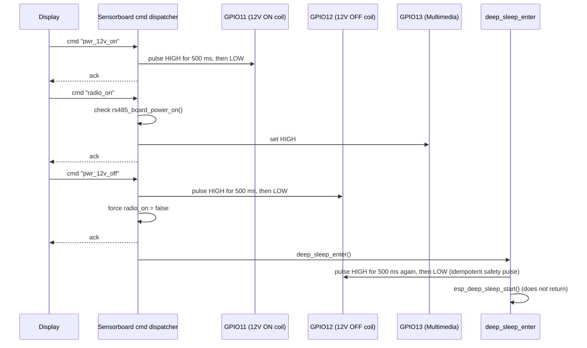
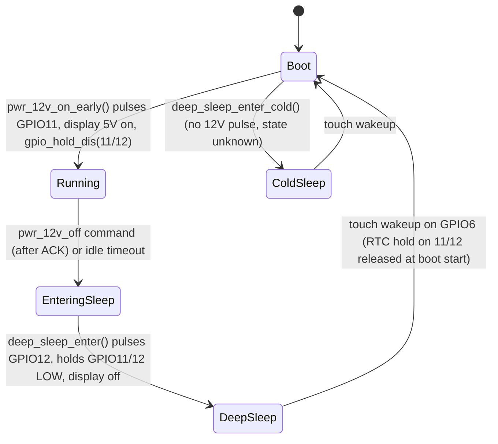

## Zweck

Die Sensorboard-Firmware (`firmware/sensorboard`) besitzt den Steuerpfad für den
12V-Hausbatteriekreis ("Bordnetz") des Campers in Richtung der Schaudt-artigen EBL
(Einbaulichtmaschine / elektronische Lade- und Verteileinheit), außerdem für die
geschaltete 5V-Display-Schiene und die 12V-Multimedia-/Radio-Schiene. Dies ist ein
sicherheitsrelevanter Pfad: ein versehentlicher Puls auf dem falschen GPIO kann die
Hausbatterie auf den 12V-Bus auf- oder abschalten. Diese Seite dokumentiert zunächst den
beabsichtigten Steuerungsablauf genau so, wie er in der Firmware spezifiziert ist, und
weist anschließend getrennt auf zwei unterschiedliche, derzeit offene Hardwareprobleme
hin: einen FET-Polaritäts-Designfehler, der das Relais komplett funktionsunfähig macht,
sowie einen davon unabhängigen physischen Schaden durch ein Verpolungsereignis am
Steckverbinder.

Siehe [Sensorboard-Architektur](../architecture/sensorboard.md) für den
Gesamtaufbau der Firmware, [RS485 / Befehlsprotokoll](rs485-protocol.md) für den
vollständigen Befehls-/Topic-Katalog und
[Hardware-Errata und offene Entscheidungen](../hardware/errata-and-open-decisions.md)
für die konsolidierte Liste der Hardwareprobleme.

## Hardware-Steuerungsoberfläche

| GPIO | Funktion | Richtung | Hinweise |
|---|---|---|---|
| 7 | Display-5V-Versorgung | Ausgang | Steuert Q5 (2N7002) → Q4 (AO3401A, P-MOSFET). HIGH = Q5 leitet → Display AN. LOW/Hi-Z = Q5 sperrt, R21 zieht das Gate von Q4 auf 5V → Display AUS. **HIGH darf auf der vorherigen Platinenrevision nicht übersprungen bzw. umgekehrt behandelt werden** — die aktuelle Revision hat Q5 genau deshalb ergänzt, um `OUTPUT HIGH` sicher zu machen. |
| 11 | 12V Bordnetz EIN (Relaisspulen-Puls "ON") | Ausgang | Muss im Ruhezustand LOW sein; ein versehentlicher Puls schaltet die Hausbatterie auf den Bus. |
| 12 | 12V Bordnetz AUS (Relaisspulen-Puls "OFF") | Ausgang | Muss im Ruhezustand LOW sein; ein versehentlicher Puls schaltet die Hausbatterie vom Bus ab. |
| 14 | 12V Bordnetz Sense/Feedback | Eingang | Liest den tatsächlichen Schienenzustand; Polarität und Gnadenfrist unten beschrieben. |
| 13 | Multimedia-/Radio-Versorgung (N-MOSFET) | Ausgang | HIGH = AN, LOW = AUS. |
| 21 | 230V-AC-Anwesenheitserkennung | Eingang | Wird im `ctrl`-Topic als `ac_present` gemeldet. |

GPIO11/GPIO12 steuern ein **bistabiles ("selbsthaltendes") Relais**: anders als ein
einfacher Schalter hält das Relais seinen letzten Zustand ohne Spulenstrom, und ein
kurzer Spannungspuls auf einem von zwei Spulen-Eingängen kippt es um. Deshalb behandelt
die Firmware GPIO11/GPIO12 als reine Puls-Ausgänge, die ansonsten bei LOW verharren
müssen — ein dauerhaftes HIGH an einem der Pins bewirkt bei einem bistabilen Relais
nichts Sinnvolles und riskiert durch Störimpulse ausgelöste ungewollte Umschaltungen.

## Befehlsablauf: `pwr_12v_on` / `pwr_12v_off` / `radio_on` / `radio_off`

Das Display sendet Steuerbefehle als `cmd`-Felder in JSON-Frames (siehe
[RS485 / Befehlsprotokoll](rs485-protocol.md) für das vollständige Frame-Format und den
Transport-Hinweis unten). Der Befehlsdispatcher des Sensorboards (`network/espnow_modem.c`,
Funktionen `rs485_set_12v_power`/`rs485_set_radio`, benannt nach dem ursprünglichen
RS485-Transport, von dem sie stammen) behandelt vier relevante Befehle:

- **`pwr_12v_on`** — setzt den kommandierten Zustand auf ON, pulst GPIO11 für
  `SENSOR_PWR_12V_PULSE_MS` auf HIGH, setzt es dann wieder auf LOW und markiert das
  `ctrl`-Topic zur sofortigen (außerplanmäßigen) erneuten Veröffentlichung.
- **`pwr_12v_off`** — setzt den kommandierten Zustand auf OFF, pulst GPIO12 für dieselbe
  Dauer auf HIGH, erzwingt `radio_on` auf `false`, falls dieses eingeschaltet war
  (die Multimedia-Versorgung darf nicht aktiv bleiben, sobald die Hausbatterie
  abgeschaltet kommandiert wird), markiert `ctrl` zur sofortigen Veröffentlichung und
  plant zusätzlich einen Deep-Sleep-Eintritt: sobald das ACK des Befehls auf der Leitung
  gesendet wurde, ruft die Firmware `deep_sleep_enter()` auf, welche vor dem Einschlafen
  noch einen eigenen, unabhängigen 12V-OFF-Puls auf GPIO12 ausführt.
- **`radio_on`** — wird mit `ESP_ERR_INVALID_STATE` abgelehnt, falls die 12V-Schiene
  derzeit nicht eingeschaltet ist (`rs485_board_power_on()` liefert false); andernfalls
  wird GPIO13 auf HIGH gesetzt.
- **`radio_off`** — setzt GPIO13 bedingungslos auf LOW.

Beide 12V-Befehle teilen sich einen Puls-Helfer und eine Puls-Längen-Konstante,
`SENSOR_PWR_12V_PULSE_MS = 500` (500 ms), die an drei Stellen identisch verwendet wird:
beim Boot-/Wake-EIN-Puls (`app_main.c`, `pwr_12v_on_early()`), beim Laufzeit-Puls, der
durch einen Display-Befehl ausgelöst wird (`espnow_modem.c`, `rs485_set_12v_power()`),
und beim Deep-Sleep-AUS-Puls (`hal/deep_sleep.c`, `deep_sleep_enter()`). Ein zunächst
getesteter kürzerer Puls von 100 ms erwies sich als unzureichend, um das physische Relais
zuverlässig umzuschalten, weshalb die Konstante überall 500 ms beträgt; Kommentare in der
Firmware weisen weiterhin darauf hin, dass das exakte Minimum nicht gegen das Datenblatt
des Relais verifiziert wurde.

*Befehlsablauf für 12V-Leistungssteuerung und Multimedia-Steuerung, einschließlich des
zweiten Sicherheitspulses, der im Deep-Sleep-Pfad nach `pwr_12v_off` ausgelöst wird.*

## Sense-Feedback und die Status-Gnadenfrist

GPIO14 ist ein einfacher digitaler Eingang, der den tatsächlichen Zustand der
12V-Schiene zurückmeldet ("LBE Spannungsfeedback"). Das `ctrl`-Topic-Feld `pwr_on`,
das periodisch (alle 2 s, plus sofort nach jedem 12V-/Radio-Befehl) veröffentlicht und
vom Display konsumiert wird, wird von diesem Sense-Pin abgeleitet, sofern
`SENSOR_PWR_12V_SENSE_ENABLE` gesetzt ist (Standardeinstellung):

- Die Polarität wird durch `SENSOR_PWR_12V_SENSE_ACTIVE_HIGH` gesteuert (derzeit auf `1`
  angenommen, d. h. 12V vorhanden → GPIO14 HIGH); Firmware-Kommentare markieren dies als
  unverifiziert gegen eine reale Messung und weisen darauf hin, dass evtl. eine Invertierung
  nötig ist, falls der Pin entgegen der Erwartung liest.
- Da die mechanische/elektrische Schiene nach einem Relaispuls Zeit zum Einschwingen
  benötigt, vertraut die Firmware dem Sense-Pin **nicht** unmittelbar nach einem Puls:
  für `SENSOR_PWR_12V_SENSE_GRACE_MS` (2500 ms) nach jedem Puls meldet `pwr_on` weiterhin
  den **kommandierten** Zustand statt des gemessenen. Erst nach Ablauf der Gnadenfrist
  wechselt der gemeldete Wert auf die live gelesene GPIO14-Messung.
- Außerhalb des Gnadenfrist-Fensters: stimmt der gemessene Sense-Wert nicht mit dem
  zuletzt kommandierten Zustand überein, protokolliert die Firmware eine Warnung und
  übernimmt den gemessenen Wert als neuen internen Zustand (auch zur Freigabe-Prüfung von
  `radio_on`-Anfragen) — der Sense-Pin gilt nach Ablauf der Gnadenfrist als maßgeblich.
- Ist `SENSOR_PWR_12V_SENSE_ENABLE` deaktiviert, degradiert `pwr_on` zu einem reinen
  Software-Flag, das lediglich den zuletzt kommandierten Zustand widerspiegelt, ohne
  jegliche Hardware-Bestätigung.

Dieses Design bevorzugt absichtlich den gerade kommandierten Zustand direkt nach einem
Puls (um ein Flackern zum falschen Wert zu vermeiden, während der Bus noch einschwingt),
während dem Display dennoch ein echter, hardwaregestützter Status geliefert wird, sobald
der Übergang Zeit hatte, sich abzuschließen.

## Regeln für Display, Multimedia und Radio-Freigabe

- Die Display-5V-Versorgung (GPIO7) wird früh während `pwr_12v_on_early()` eingeschaltet,
  noch vor den meisten anderen Initialisierungsschritten, und wird durch Setzen von
  GPIO7 auf LOW wieder ausgeschaltet (niemals in einem Zustand belassen, in dem es
  unbeabsichtigt HIGH werden könnte) — auf der aktuellen Platine steuert GPIO7 einen
  N-Kanal-Vortreiber (Q5) vor dem P-Kanal-Lastschalter (Q4), was die Firmware-Kommentare
  als bedingungslos sicher für `OUTPUT HIGH` beschreiben (anders als bei früheren
  Platinenrevisionen).
- Die Multimedia-/Radio-Versorgung (GPIO13) ist ein einfaches N-MOSFET-Gate: HIGH = an,
  LOW = aus, ohne bistabiles Verhalten und ohne dass über den Schlaf hinweg ein
  GPIO-Hold erforderlich wäre.
- `radio_on` wird nur berücksichtigt, solange die 12V-Schiene als eingeschaltet gemeldet
  wird; das Abschalten der 12V-Schiene erzwingt stets auch das Abschalten des Radios als
  Nebeneffekt — sowohl um die physische Realität widerzuspiegeln (das Multimedia-System
  hat ohne die 12V-Schiene keine Versorgung) als auch um den internen Zustand
  `s_radio_on` der Firmware konsistent mit dem zu halten, was dem Display als Nächstes
  mitgeteilt wird.

## Deep Sleep und Touch-Wakeup

Das Sensorboard nutzt den Deep-Sleep-Modus des ESP32-S3 mit kapazitivem Touch-Wakeup
(GPIO6 / Touch-Pad 6) als wichtigsten Ruhemechanismus, implementiert in `hal/deep_sleep.c`:

- `deep_sleep_init()` kalibriert einmalig beim Booten eine Touch-Baseline und einen
  Schwellenwert (`SENSOR_WAKEUP_TOUCH_THRESHOLD_PCT`), da sich der eingebaute
  Glättungs-/Benchmark-Filter des ESP32-S3 auf dieser Hardware als unbrauchbar erwies
  (er meldet konstant `0x3FFFFF`); die Firmware weicht stattdessen auf rohe Touch-Messwerte
  aus.
- `deep_sleep_enter()` (regulärer Pfad, erreicht über `pwr_12v_off` wie oben beschrieben
  oder über andere Idle-Auslöser) schaltet Peripherie in fester Reihenfolge ab: Display-5V
  aus mit einem RTC-GPIO-Hold, damit es über den Schlaf hinweg aus bleibt, HX711 und
  BNO055 in Stromsparmodi versetzt, ein 12V-OFF-Relaispuls mit anschließendem Einfrieren
  von GPIO11/GPIO12 auf LOW via `gpio_hold_en()`, Multimedia-/Licht-/Pumpen-Pins auf LOW
  gesetzt (kein Hold nötig, da dies einfache FET-Gates ohne zu schützenden bistabilen
  Zustand sind) und der Pin der veralteten RS485-DE-Leitung auf LOW gesetzt. Anschließend
  aktiviert es `ESP_PD_DOMAIN_RTC_PERIPH` (erforderlich, damit der Touch-FSM während des
  Schlafs aktiv bleibt) und ruft `esp_sleep_enable_touchpad_wakeup()` vor
  `esp_deep_sleep_start()` auf, das nicht zurückkehrt.
- `deep_sleep_enter_cold()` ist eine Boot-Zeit-Variante, die genutzt wird, wenn das Gerät
  direkt schlafen gehen soll, ohne zuvor eine 12V-Zustandsänderung zu bewirken: es friert
  GPIO11/GPIO12 LOW (Ruhezustand) ein, ohne einen Relaispuls auszulösen, da der tatsächliche
  Zustand des bistabilen Relais an diesem Punkt unbekannt/unverändert ist und ein
  versehentlicher Puls vermieden werden muss.
- Beim Aufwachen ruft `app_main()` explizit `gpio_hold_dis()` für GPIO11 und GPIO12 auf,
  noch bevor ein `gpio_config()`-/`gpio_set_level()`-Aufruf erfolgt. Dies ist notwendig,
  weil der RTC-GPIO-Hold von ESP-IDF über einen Touch-Wakeup hinweg bestehen bleibt: ein
  zuvor behobener Firmware-Fehler (2026-08-30) ließ diesen Aufruf aus, wodurch GPIO11/GPIO12
  (und während der Fehlersuche auch GPIO17) nach jedem Touch-Wakeup unabhängig von
  späteren `gpio_set_level()`-Aufrufen in der Software auf ihrem Zustand vor dem Schlaf
  eingefroren blieben — ein reales, durch Hardwaretests bestätigtes Verhalten, das nun
  dadurch behoben ist, dass der Hold-Disable-Aufruf bedingungslos ganz am Anfang von
  `app_main()` erfolgt.

*Lebenszyklus des Boards über Boot, Betrieb und die beiden Deep-Sleep-Eintrittspfade, sowie
wann die 12V-Relais-Pins bei welchem Übergang gepulst werden (oder auch nicht).*

## ⚠️ Bekannter Hardwarefehler: Relais schaltet nie (Q1/Q2-FET-Polarität)

Dies ist der aktuelle, as-built ("Ist-Zustand") Hardwarestand, entdeckt im September 2026,
nachdem beobachtet wurde, dass das Relais unabhängig von Pulslänge (100/500/1000 ms wurden
alle getestet) oder Sense-Pin-Verhalten nicht schaltet:

- Die physischen Relais-Treibertransistoren Q1/Q2 am Steckverbinder J7 (genutzt für die
  Spulenpulse "12V EIN" / "12V AUS") sind als **IRLML2244, P-Kanal-MOSFETs in
  High-Side-Beschaltung** bestückt (Source an +12V, Drain an den J7-Pin, Flyback-Diode
  SS14 zurück zu +12V). Im "aktiven" Zustand legt diese Topologie **+12V** auf den
  Relaisspulen-Pin.
  - Das EBL-/Relaismodul erwartet das Gegenteil: ein **Pull-to-GND-Signal (Low-Side)** auf
    diesen beiden Pins. Die Relaisspule ist auf der EBL-Seite bereits intern mit +12V
    verbunden; der ursprüngliche Schaudt-Taster erdet den Pin nur kurzzeitig, um die Spule
    zu erregen.
  - Da an beiden Enden der Spule effektiv +12V anliegt, gibt es keine Spannungsdifferenz
    über ihr, sodass **das Relais unabhängig von der Software niemals schaltet** — Pulslänge,
    Timing und die GPIO14-Sense-Schaltung sind für diesen Fehlerfall allesamt irrelevant;
    es handelt sich rein um ein Problem der falschen Transistor-Topologie.
- **Vorgeschlagene Abhilfe (noch nicht verifiziert):** Q1/Q2 durch **IRLML6244**
  (N-Kanal, identischer SOT-23-Footprint/Pinout) ersetzen, unter der Annahme, dass die
  Source des Transistors bereits mit GND verbunden ist und das Gate direkt vom GPIO
  angesteuert wird. Es wird angenommen, dass es sich um einen einfachen
  Bauteil-Verwechslungsfehler handelt (IRLML2244 vs. IRLML6244 — eine Verwechslung einer
  einzigen Ziffer) und nicht um ein Layoutproblem; weitere als Low-Side-N-Kanal
  dokumentierte Kanäle (Licht, Pumpe, Multimedia) sind vermutlich nicht vom selben Fehler
  betroffen. Vor Bestellung der Ersatzteile sollte die Source-Verbindung von Q1/Q2 gegen
  den Schaltplan geprüft werden. Nach dem Tausch können die SS14-Flyback-Dioden an Q1/Q2
  vermutlich entfernt werden (die EBL hat ihre eigenen), sollten aber bei einer
  gleichartigen Korrektur an den Licht-/Pumpen-Kanälen **beibehalten** werden, da diese
  eine induktive Pumpenmotorlast ansteuern.
- Bis diese Abhilfe angewendet und auf der Hardware verifiziert ist, sind
  `pwr_12v_on`/`pwr_12v_off` am physischen Hausbatterie-Relais effektiv wirkungslos
  (No-ops), obwohl der oben beschriebene Firmware-Befehlsablauf, das Pulstiming und das
  Sense-Feedback alle normal ablaufen und Erfolg melden.

## ⚠️ Separates Problem: Schaden durch Verpolung am Steckverbinder (GPIO13/17, möglicherweise 11/12)

Dies ist ein eigenständiges, schwerwiegenderes Problem als der oben beschriebene
Q1/Q2-Designfehler — es handelt sich um **physischen Schaden**, nicht um eine falsche
Verdrahtungstopologie, und es betrifft eine bestimmte physische Platine, nicht jede nach
dem aktuellen Design gefertigte Platine:

- Am 30.08.2026 wurde der Steckverbinder J7 ("LT452 Malibu", 10-poliger Molex Micro-Fit)
  verpolt zusammengesteckt. Während dieses Ereignisses wurde die Multimedia-Leitung
  (GPIO13) auf GND gezogen, während der ESP32-Ausgang auf HIGH gesteuert wurde, wodurch
  die Ausgangsstufe hart kurzgeschlossen wurde (der Ausgangstreiber ist vermutlich
  dauerhaft beschädigt — der Pin liest nun unabhängig von Softwarebefehlen LOW). GPIO17
  (Licht) war einem vertauschten 12V-Steuersignal ausgesetzt, vermutlich Überspannung.
  GPIO18 (Pumpe) war am selben Steckverbinder während desselben Vorfalls, wurde aber
  **nicht** beschädigt.
- Die 12V-Bordnetz-"EIN"-/"AUS"-Steuerleitungen (GPIO11/GPIO12) sind laut Schaltplan
  ebenfalls über J7 geführt und wurden im Bericht zum Verpolungsvorfall als vertauscht
  gemeldet. Eine Benutzermessung mit einem MIN/MAX-Multimeter (Metrahit 28S,
  0,05-s-Abtastung) deutet darauf hin, dass diese Pins ebenfalls beschädigt sein könnten,
  dies wurde jedoch **noch nicht abschließend verifiziert**.
- Für physischen Transistor-/Ausgangsstufenschaden ist kein Software-Fix möglich. Es
  wurde entschieden, **kein** Pin-Remapping auf dieser Platine vorzunehmen; stattdessen
  wurde eine neue Platinenrevision bestellt (korrigierte J7-Verdrahtung, RS485-Transceiver
  entfernt, Q5-Display-Vortreiber korrekt gepolt). Die aktuellen Pin-Zuordnungen in
  `sensor_config.h` (GPIO13/17/18) sind für diese neue, unbeschädigte Platinenrevision
  geschrieben.
- Da der sicherheitskritische 12V-Hausbatterie-Steuerungspfad (GPIO11/GPIO12) selbst zu
  den auf der betroffenen physischen Platine beschädigten Pins gehören könnte, gilt diese
  Platine als **für den Normalbetrieb nicht nutzbar** — unabhängig von und zusätzlich zu
  dem oben beschriebenen Q1/Q2-Designfehler. Selbst wenn Q1/Q2 behoben sind, könnte diese
  spezifische Platine für das 12V-Schalten weiterhin unsicher sein, bis der vermutete
  GPIO11/12-Schaden entweder ausgeschlossen oder eine Ersatzplatine verwendet wird.

## Betriebliche Auswirkungen

- Aufgrund des Q1/Q2-Fehlers ist jede Sicherheitsannahme, dass "der 12V-Schalter des
  Displays die Hausbatterie steuert", derzeit in der Praxis falsch; der Relaiszustand ist
  der, in dem er zuletzt von Hand/manuell belassen wurde, unabhängig von den Befehlen
  `pwr_12v_on`/`pwr_12v_off`.
- Das sense-basierte Feedback der Firmware (`pwr_on` im `ctrl`-Topic) verfolgt weiterhin
  GPIO14, sobald die Gnadenfrist abgelaufen ist; sofern die Verdrahtung von GPIO14 selbst
  korrekt ist, zeigt das Display korrekt an, dass sich der Schienenzustand nach einem
  Befehl **nicht** geändert hat — dies ist das erwartete (wenn auch verwirrende) Symptom
  dieses Fehlers vor der Q1/Q2-Korrektur.
- Es gibt derzeit keinen automatischen Unterspannungsschutz für den
  12V-Hausbatteriekreis — das Sensorboard schaltet das Relais nur auf expliziten
  Display-Befehl; eine softwarebasierte Trennung (vergleichbar mit einem
  EBL-"Batteriewächter"-Unterspannungsabschaltung) ist ein offenes, noch nicht
  implementiertes Feature, das separat verfolgt wird.
- Jede Firmware- oder Hardwareänderung am Verhalten von GPIO11/GPIO12 sollte gegen beide
  oben genannten Probleme gegengeprüft werden: eine Behebung von Q1/Q2 bestätigt für sich
  genommen nicht, dass die GPIO11/GPIO12-Leiterbahnen und Ausgangsstufen einer bestimmten
  physischen Platine den Verpolungsvorfall überstanden haben.
