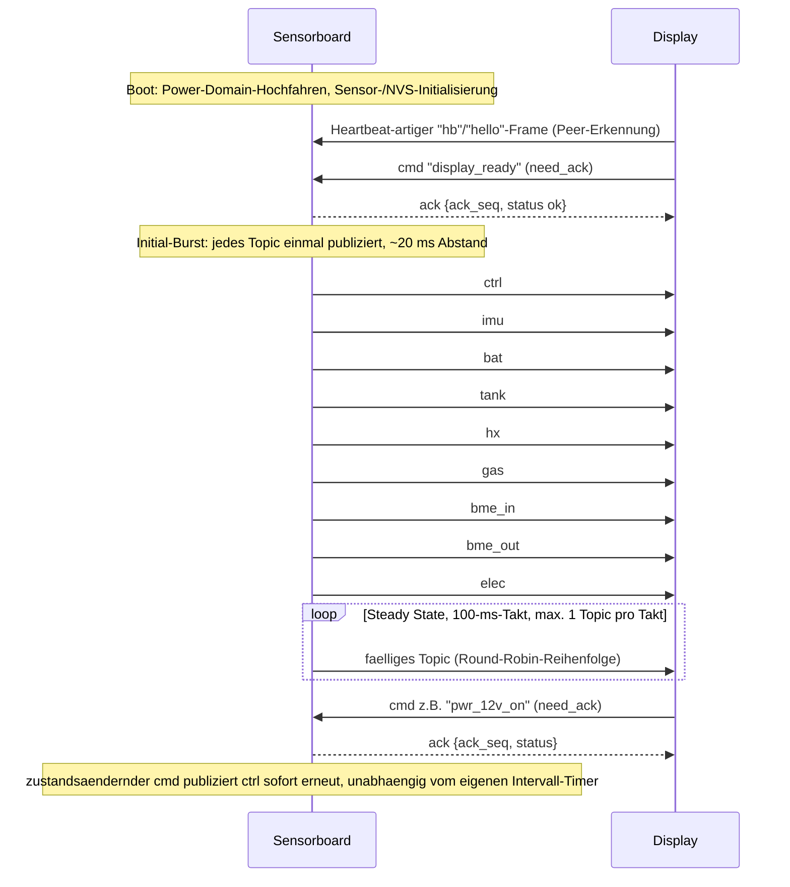

## Zweck und Geltungsbereich

Diese Seite ist die maßgebliche Beschreibung des projektinternen „RS485"-Topic-Protokolls —
des JSON-Nachrichtenvertrags, über den die Sensorboard- und Display-Knoten Telemetrie- und
Kommandodaten austauschen. Sie behandelt die Frame-Struktur, den Round-Robin-Publishing-
Scheduler, die ACK-/Kommando-Behandlung, die vollständige Topic-Tabelle (Namen, Intervalle,
Felder) sowie das vom Display ausgehende Kommando-Set.

Das Protokoll ist, in leicht voneinander abweichenden Formulierungen, an zwei Stellen
spezifiziert, die eigentlich synchron gehalten werden sollen: im Abschnitt „RS485-Protokoll"
von `firmware/sensorboard/README.md` (die Sensorboard-Seite, die jedes Topic tatsächlich
serialisiert und publiziert) und im Abschnitt „RS485-Schnittstelle" von
`firmware/display/CLAUDE.md` (die Display-Seite, die Topics konsumiert und Kommandos
ausgibt). `firmware/shared/womo_config.h` wird in beide Firmware-Images eingebunden und soll
die einzige Quelle der Wahrheit für die numerischen Konstanten (Topic-Intervalle, Timeouts,
Handshake-Intervalle) sein, auf die beide Dokumente verweisen. Diese Seite behandelt alle
drei als Quellen der Wahrheit und benennt jede Stelle, an der sie sich widersprechen, statt
sie stillschweigend aufzulösen.

Für den Hardware-/Pin-Kontext der jeweiligen Knoten siehe
[Display-Architektur](../architecture/display.md) und
[Sensorboard-Architektur](../architecture/sensorboard.md); dazu, wie BLE-Sensormesswerte in
die hier dokumentierten Topics `hx`/`gas`/`bme_in`/`bme_out`/`*_scan` einfließen, siehe
[BLE-Datenfluss](ble-data-flow.md); zur Wirkung der Kommandos `pwr_12v_on/off` und
`radio_on/off` auf die Stromversorgung des Fahrzeugs siehe [Power Control](power-control.md).

## Frame-Struktur

Jeder Frame — in beide Richtungen — ist ein einzeiliges, CRLF-terminiertes JSON-Objekt aus
druckbaren ASCII-Zeichen (0x20–0x7E):

- Ein `type`-Feld (bei vom Sensorboard ausgehender Telemetrie/Events) oder ein `cmd`-Feld
  (bei vom Display ausgehenden Kommandos) identifiziert den Frame.
- `seq` (u32) ist eine pro Sender monoton steigende Sequenznummer.
- `ts` ist ein Zeitstempel in Millisekunden seit der Epoche.
- `need_ack` (bool) teilt dem Empfänger mit, ob er mit einem ACK antworten soll; das
  Sensorboard fordert i. d. R. ein ACK an, sobald das Display sich als bereit gemeldet hat.
(Quelle: repo://firmware/display/CLAUDE.md#L17-L21)

**Dokumentiertes ACK-Format vs. das, was die Firmware tatsächlich sendet.**
`display/CLAUDE.md` dokumentiert den ACK-Frame als
`{"type":"ack","ack":<seq>,"status":"ok"|"err","cmd":"<label>","err":"<text>"}`. Die
aktuelle Sensorboard-Implementierung (`network/espnow_modem.c`, das Modul, das dieses
Protokoll inzwischen trägt — siehe unten) sendet stattdessen
`{"type":"cmd_ack","ack_seq":<seq>,"status":"ok"|"error","cmd":"<label>","err":"<text>"}`:
Das `type`-Feld des Frames lautet `cmd_ack` (nicht `ack`), das Sequenznummer-Feld heißt
`ack_seq` (nicht `ack`), und der Fehlerstatus-String lautet `"error"` (nicht `"err"`). Wer
ausschließlich gegen die dokumentierte Form implementiert, parst das tatsächliche
Wire-Format falsch.
(Quelle: repo://firmware/display/CLAUDE.md#L21, repo://firmware/sensorboard/main/network/espnow_modem.c#L260-L272)

Eingehende Frames gelten implizit als ACK-pflichtig, sobald sie eine von Null verschiedene
`seq` tragen — auch ohne explizites `need_ack:true`; das explizite Flag erzwingt die
Entscheidung nur in die eine oder andere Richtung.
(Quelle: repo://firmware/sensorboard/main/network/espnow_modem.c#L1590-L1605)

## Physikalische Schicht: UART 57600 8N1, und das ESP-NOW, über das sie inzwischen läuft

Laut beiden Firmware-Projekten ist die Transportschicht auf Leitungsebene für dieses
Protokoll eine Halbduplex-RS485-Verbindung (MAX3485-Transceiver) mit **57600 Baud, 8N1** und
automatischem DE/RTS-Toggle. **115200 Baud wurde ausprobiert und wieder verworfen**: Es
verursachte UART-Framing-Fehler, weil das DE-Toggle-Timing rund um den Transceiver bei der
höheren Rate nicht mehr mithalten konnte. 57600 8N1 ist der korrekte, aktuell gültige Wert
für diese verdrahtete RS485-Konfiguration — 115200 ist ein gelöstes historisches Problem,
keine derzeit zu erwägende Option.
(Quelle: repo://firmware/display/CLAUDE.md#L18, repo://firmware/sensorboard/README.md#L19)

Pins wie dokumentiert: Sensorboard TX=GPIO9, RX=GPIO10, DE=GPIO8 (über `modem_config.h`,
laut der Hardware-Tabelle in `sensorboard/README.md`); `display/CLAUDE.md` nennt separat
TX=GPIO12, RX=GPIO11, DE/RTS=GPIO21 für die „modem_config.h" des Sensorboards — diese beiden
Dokumente widersprechen sich bei den RS485-Pinnummern des Sensorboards für dieselben
Signale, was erwähnenswert ist für alle, die anhand der Dokumentation allein einen
RS485-Testaufbau verkabeln wollen.
(Quelle: repo://firmware/sensorboard/README.md#L19, repo://firmware/display/CLAUDE.md#L19)

**Aktuelle Transport-Realität.** Die auf dieser Seite beschriebenen JSON-Frames, Topic-Namen
und das Kommando-Vokabular sind in der aktuellen Firmware im Wesentlichen unverändert
implementiert, aber der physische Träger in der aktuellen Firmware ist **ESP-NOW**, nicht
der verdrahtete RS485-UART-Bus, den der Baudraten-Abschnitt oben beschreibt. Auf dem
Sensorboard ist das Modul, das jeden Frame dieser Seite aufbaut und parst,
`network/espnow_modem.c` (seine internen Funktionen heißen weiterhin `rs485_*` —
`rs485_publish_ctrl`, `rs485_send_frame`, `rs485_process_rx_line` usw. — ein Namensrelikt
aus dem UART-zeitlichen Vorgängermodul `rs485_modem.c`, das es ersetzt hat), und es
sendet/empfängt Bytes über `network/espnow_transport.c`, einen ESP-NOW-Wrapper, keinen
UART-Treiber. Die ursprünglichen RS485-Pins (GPIO8/9/10) werden nicht mehr als UART
angesteuert; GPIO8 wird nur noch als Schutz gegen ein floatendes Pin auf LOW gehalten. Der
Abschnitt „Projektstruktur" in `sensorboard/README.md` listet weiterhin `network/rs485_modem`
und `network/womo_rs485` als relevante Module — keine dieser Dateien existiert im aktuellen
Baum, was selbst eine Abweichung zwischen diesem Dokument und dem Code ist. Die hier
dokumentierten Topic-Intervalle, das Kommando-Set und die ACK-Semantik sind unabhängig
davon, welcher Transport sie trägt, aber die Details zu 57600-8N1/Pins oben sind als
**historische/verdrahtete Konfiguration** zu lesen, auf der das JSON-Protokoll ursprünglich
entstanden ist, nicht als Beschreibung des heutigen Stands. Siehe
<!-- openwiki: broken internal link [../architecture/display.md#current-transport-esp-now-not-a-physical-rs485-bus] heading anchor "current-transport-esp-now-not-a-physical-rs485-bus" does not exist in "../architecture/display.md". Fix the href or restore the target, then delete this comment. -->
[Display-Architektur](../architecture/display.md#current-transport-esp-now-not-a-physical-rs485-bus)
und [Sensorboard-Architektur](../architecture/sensorboard.md) für die vollständige
Diskussion der Transport-Abweichung; ein eigenständiger Testaufbau für die verdrahtete
RS485-Bring-up existiert weiterhin unter `tests/02_RS485_Test/`.
(Quelle: repo://firmware/sensorboard/main/network/espnow_modem.c#L1-L50, repo://firmware/sensorboard/main/network/espnow_transport.c#L1-L50, repo://firmware/sensorboard/README.md#L164-L173, repo://firmware/sensorboard/main/sensor_config.h#L83-L87)

Eine weitere Folge dieser Migration betrifft die **Richtung von hello/heartbeat**: Sowohl
`sensorboard/README.md` als auch `display/CLAUDE.md` beschreiben `hello`/`hb` als Frames,
die das Sensorboard periodisch an das Display sendet. Im aktuellen `espnow_modem.c` sendet
das Sensorboard gar keine `hello`/`hb`-Frames; stattdessen *empfängt* es lediglich
`type:"hb"`/`"hello"`-Frames (ohne sie zu quittieren) und wertet sie als Beweis, dass der
Display-Peer lebt, während die eigentliche ESP-NOW-Peer-Erkennung von `espnow_transport`
übernommen wird. Das deckt sich mit dem Kommentar zu `womo_config.h`s eigenem
`WOMO_SENSOR_HEARTBEAT_INTERVAL_MS`, der besagt, dass das **Display** einen Heartbeat
sendet, damit das **Sensorboard** es als seinen ESP-NOW-Peer erkennen kann — die
entgegengesetzte Richtung zur Darstellung „Periodik vom Sensorboard: hello, hb" im README.
Wer einen neuen Peer gegen dieses Protokoll implementiert, sollte der Code-/`womo_config.h`-
Richtung mehr vertrauen als dem Fließtext in der Topic-Tabelle von `sensorboard/README.md`.
(Quelle: repo://firmware/sensorboard/main/network/espnow_modem.c#L1616-L1623, repo://firmware/shared/womo_config.h#L29-L31, repo://firmware/sensorboard/README.md#L41-L45)

## Handshake, Initial-Burst und Round-Robin-Scheduling

_Boot, Handshake, Initial-Topic-Burst, Round-Robin im Steady State sowie der Kommando-/
ACK-Pfad, wie im TX-Task des Sensorboards implementiert._

- **Round Robin:** Ein 100-ms-Takt durchläuft die Topic-Liste beginnend beim Index nach dem
  zuletzt gesendeten Topic und publiziert das erste Topic, dessen Intervall abgelaufen ist —
  höchstens ein Topic pro Takt. On-Demand-Frames (`ruuvi_scan`, `gasbee_scan`,
  `gasbee_cal_result`) verbrauchen dasselbe „ein Frame pro Takt"-Budget und verdrängen daher
  vorübergehend die regulären Round-Robin-Topics, solange ein Scan- oder
  Kalibrierungsergebnis unterwegs ist.
  (Quelle: repo://firmware/sensorboard/main/network/espnow_modem.c#L1387-L1399, repo://firmware/sensorboard/main/network/espnow_modem.c#L1656-L1729)
- **Bereitschaft („Readiness"):** Das Sensorboard wechselt in den „ready"-Zustand entweder
  beim Empfang eines expliziten `cmd:"display_ready"`, oder — im aktuellen ESP-NOW-Build —
  sobald die Transportschicht das Display als bekannten Peer erkennt, je nachdem was zuerst
  eintritt. Das Erreichen von „ready" löst den einmaligen Initial-Burst aus (jedes Topic
  wird hintereinander publiziert, ~20 ms Abstand), bevor der reguläre intervallbasierte
  Round Robin übernimmt.
  (Quelle: repo://firmware/sensorboard/main/network/espnow_modem.c#L321-L347, repo://firmware/sensorboard/main/network/espnow_modem.c#L1669-L1676)
- **Sofortiges ctrl-Republish:** Nach Ausführung von `pwr_12v_on/off` oder `radio_on/off`
  setzt das Sensorboard den Intervall-Timer von `ctrl` zurück und publiziert es sofort
  erneut (`s_ctrl_immediate`), damit das Display den neuen Power-/Radio-Zustand anzeigt,
  ohne auf das reguläre `ctrl`-Intervall warten zu müssen.
  (Quelle: repo://firmware/display/CLAUDE.md#L36, repo://firmware/sensorboard/main/network/espnow_modem.c#L1507-L1520, repo://firmware/sensorboard/main/network/espnow_modem.c#L1677-L1682)
- **Merge auf der Display-Seite:** Jedes empfangene Topic aktualisiert nur seinen eigenen
  Teilbereich im Snapshot `s_latest_data`/`latest_sensor_data` des Displays; alle anderen
  Felder bleiben unangetastet, und unbekannte/fehlende JSON-Felder werden ignoriert statt
  als Fehler behandelt — das Hinzufügen eines neuen optionalen Feldes zu einem Topic ist
  somit abwärtskompatibel.
  (Quelle: repo://firmware/display/CLAUDE.md#L41)

## ACK-Behandlung und Kommando-Timeouts

- Der Sender eines Frames, der eine Bestätigung benötigt (`need_ack`), trägt ihn vor dem
  Senden in eine kleine Tabelle ausstehender Kommandos ein, indiziert nach `seq` und einem
  menschenlesbaren Label.
- Eine Hintergrundprüfung läuft bei jedem Scheduler-Takt (100 ms): Sobald ein ausstehendes
  Kommando `WOMO_SENSOR_COMMAND_TIMEOUT_MS` (3000 ms) überschreitet, wird einmalig eine
  Timeout-Warnung geloggt; bleibt es auch nach dem **3-fachen** dieses Timeouts (insgesamt
  9 s) unaufgelöst, wird der Slot unabhängig davon freigegeben, ob je ein ACK eintrifft —
  ein verlorenes ACK kann den Pool ausstehender Kommandos somit nicht dauerhaft erschöpfen.
- Es dürfen höchstens `WOMO_SENSOR_MAX_PENDING_CMDS` (4) Kommandos gleichzeitig ausstehen;
  ein fünftes gleichzeitiges `need_ack`-Senden schlägt bei der Registrierung fehl und loggt
  nur eine Warnung — es blockiert nicht das Senden des Frames selbst.
- Beim Empfang eines `type:"ack"`/`"cmd_ack"`-Frames wird der zur Sequenznummer passende
  ausstehende Slot aufgelöst (Erfolg/Fehlschlag wird geloggt); der Sender wiederholt
  fehlgeschlagene oder abgelaufene Kommandos derzeit nicht automatisch — das Display ist
  dafür zuständig, zu entscheiden, ob ein Kommando, dessen ACK nie eintraf, erneut gesendet
  wird.
(Quelle: repo://firmware/shared/womo_config.h#L29-L37, repo://firmware/sensorboard/main/network/espnow_modem.c#L165-L226, repo://firmware/sensorboard/main/network/espnow_modem.c#L254-L257)

Ein `pwr_12v_off`-Kommando setzt zusätzlich ein „Shutdown ausstehend"-Flag, das erst *nach*
dem Versand des eigenen ACKs auslöst, sodass das Display garantiert die Bestätigung des
Kommandos sieht, bevor das Sensorboard in den Deep Sleep geht.
(Quelle: repo://firmware/sensorboard/main/network/espnow_modem.c#L1511-L1515, repo://firmware/sensorboard/main/network/espnow_modem.c#L1646-L1650)

## Topic-Katalog

Topic-Namen und Felder unten sind aus der Tabelle „RS485-Protokoll" in
`sensorboard/README.md` übernommen, da das Sensorboard der Producer ist, der jedes Topic
tatsächlich serialisiert. Die **Intervall**-Spalten vergleichen die drei Stellen, an denen
ein Intervall angegeben ist; siehe „Bekannte Intervall- und Feld-Inkonsistenzen" unten dazu,
was die Abweichungen in der Praxis bedeuten.

| Topic | Intervall (README.md) | Konstante (`womo_config.h`) | Intervall (CLAUDE.md) | Felder |
|---|---|---|---|---|
| `hello` | bis bereit | — | bis bereit (implizit) | `fw`, `board`, `uptime`, `ts` |
| `hb` | 30 s | — | nicht angegeben | `uptime`, `ts`, `heap` |
| `ctrl` | 2 s | `WOMO_TOPIC_CTRL_INTERVAL_MS` = 2000 ms | 2 s | `pwr_on` (12V-Sense, GPIO14), `radio_on`, `ac_present`; optional `rtc_bat_low`, `rtc_bat_switched` |
| `imu` | 5 s | `WOMO_TOPIC_IMU_INTERVAL_MS` = 2000 ms | 1 s | `yaw_deg`, `pitch_deg`, `roll_deg`, `hdg`, `cal:{sys,gyro,acc,mag}`, `calibrated`, `ts` |
| `bat` | 10 s | `WOMO_TOPIC_BAT_INTERVAL_MS` = 5000 ms | 1 s | `b1`, `b2` (Volt), `nc1`, `nc2` |
| `tank` | 10 s | `WOMO_TOPIC_TANK_INTERVAL_MS` = 10000 ms | 10 s | `t1`, `t2` (%), `nc1`, `nc2`, `t1_l`, `t2_l` (Liter), `t1_rate1h`, `t1_rate2h`, `t1_rest_h`, `t2_rate1h`, `t2_rate2h`, `t2_rest_h` |
| `hx` | 10 s | `WOMO_TOPIC_HX_INTERVAL_MS` = 10000 ms | 10 s | `src` (`hx`/`ble`/`none`), `a`, `b` (kg, optional), `sum` (optional), `nc`, `ts`; bei `src:"ble"` zusätzlich je Flasche `batt_a_mv`/`batt_a_pct`, `chg_a`, `cal_a`, `cfg_a` (nur während USB-/Konfigurationsmodus; analog `_b`) |
| `gas` | 10 s | `WOMO_TOPIC_GAS_INTERVAL_MS` = 10000 ms | 10 s | `src`, `active`, `net`, `rate1h`, `rate2h`, `rest_h`, `net_a`, `net_b`, `cap_kg`, `pct`, `pct_a`, `pct_b` |
| `bme_in` | 15 s | `WOMO_TOPIC_BME_INTERVAL_MS` = 10000 ms | 10 s | `chip` (`bme680`/`bme280`/`bme260`/`ruuvi`), `addr`?, `temp_c`, `rh_pct`, `press_hpa`, `ts`; bei BME680 zusätzlich `gas_kohm`? (wenn Gas-Messwert gültig), `iaq`, `iaq_acc` (0–3), `eco2_ppm`, `bvoc_ppm` (erst nach BSEC-Burn-in); bei Ruuvi-Fallback zusätzlich `batt_mv`? |
| `bme_out` | 15 s | `WOMO_TOPIC_BME_INTERVAL_MS` = 10000 ms (gemeinsam mit `bme_in`) | 10 s | `chip`, `addr`?, `temp_c`, `rh_pct`, `press_hpa`, `ts`, `press_trend_state`?, `press_trend_hpa_h`?, `gas_kohm`? (wenn gültig); **kein** `iaq`/`eco2`/`bvoc` für den Außensensor; bei Ruuvi-Fallback zusätzlich `batt_mv`? |
| `elec` | 5 s | `WOMO_TOPIC_ELEC_INTERVAL_MS` = 1000 ms | 1 s | `v_bus` (V), `i_a` (A), `p_w` (W), `v_shunt_mv` (mV), `ts`; `nc:true` wenn INA226 nicht gefunden |
| `ruuvi_scan` | nur auf Anfrage | — | nur auf Anfrage | ein Frame pro gesehenem Ruuvi-Tag: `sid`, `idx`, `cnt` (0 = keiner) + `mac`, `rssi`, `temp_c`, `has_pressure`, `age_s`; Antwort auf `cmd:"ruuvi_scan_request"` |
| `gasbee_scan` | nur auf Anfrage | — | nur auf Anfrage | ein Frame pro gesehenem GasBee: `sid`, `idx`, `cnt` (0 = keiner) + `mac`, `rssi`, `weight_kg`, `batt_mv`, `batt_pct`, `chg`, `cal`, `cfg`, `bee_seq`, `age_s`; Antwort auf `cmd:"gasbee_scan_request"` |
| `gasbee_cal_result` | nach `gasbee_cal` | — | nicht angegeben | `step` (`zero`/`ref`), `ok`, `err` (0 = ok, >0 = GasBee-ATT-Fehler, <0 = sensorboardseitiger Fehler), `msg` |

(Quelle: repo://firmware/sensorboard/README.md#L43-L58, repo://firmware/shared/womo_config.h#L43-L50, repo://firmware/display/CLAUDE.md#L23-L39, repo://firmware/sensorboard/main/network/espnow_modem.c#L1387-L1397)

Code-Abgleich: Die Live-Topic-Liste und die Intervall-Konstanten im Array `s_topics[]` von
`espnow_modem.c` stimmen exakt mit den Konstanten aus `womo_config.h` überein (sie werden
direkt per `#include` eingebunden), was bestätigt, dass `womo_config.h` — und nicht eine der
Fließtext-Tabellen in README/CLAUDE — zur Laufzeit die tatsächliche Quelle der Wahrheit für
jedes Intervall ist.
(Quelle: repo://firmware/sensorboard/main/network/espnow_modem.c#L1387-L1399)

## Bekannte Intervall- und Feld-Inkonsistenzen

Die beiden Dokumente, aus denen diese Seite ihren Inhalt übernimmt (`sensorboard/README.md`
und `womo_config.h`), widersprechen sich gegenseitig, und `display/CLAUDE.md` widerspricht
beiden in mehreren Punkten. Keiner dieser Widersprüche wird oben stillschweigend aufgelöst;
sie werden hier explizit aufgeführt:

- **Intervalle, die sich über alle drei Quellen hinweg unterscheiden:** `imu` (README 5 s /
  config 2 s / CLAUDE 1 s), `bat` (README 10 s / config 5 s / CLAUDE 1 s), `bme_in`/`bme_out`
  (README 15 s / config 10 s / CLAUDE 10 s), `elec` (README 5 s / config 1 s / CLAUDE 1 s).
  Nur `ctrl`, `tank`, `hx` und `gas` stimmen über alle drei Quellen hinweg überein. Da die
  Tabelle `s_topics[]` der Firmware die Makros aus `womo_config.h` direkt einbindet, ist der
  Wert aus `womo_config.h` das, was tatsächlich ausgeliefert wird; die Fließtext-Tabellen in
  README und CLAUDE.md sind für vier der acht geplanten Topics veraltet.
- **`hb`-Felder:** `sensorboard/README.md` listet `uptime`, `ts`, `heap`; `display/CLAUDE.md`
  listet stattdessen `uptime` sowie optional `rx_seq`/`last_ack`, ohne `heap` oder `ts`.
- **`hello`-Felder:** `sensorboard/README.md` listet `fw`, `board`, `uptime`, `ts`;
  `display/CLAUDE.md` listet nur `fw`, `uptime` sowie optional `rx_seq`/`last_ack` — `board`
  und `ts` fehlen, dafür werden Felder eingeführt, die das README nicht erwähnt.
- **`tank`-Felder:** Die Topic-Zeile in `display/CLAUDE.md` nennt nur `t1`, `t2`, `nc1`,
  `nc2` und lässt die Felder `t1_l`/`t2_l` (Liter) sowie die Verbrauchsraten-Felder
  `*_rate1h`/`*_rate2h`/`*_rest_h` aus, die `sensorboard/README.md` dokumentiert und die das
  Sensorboard tatsächlich publiziert.
- **`bme_in`-Trend-Felder:** `display/CLAUDE.md` listet `press_trend_state?`/
  `press_trend_hpa_h?` als mögliche `bme_in`-Felder, aber `sensorboard/README.md`
  dokumentiert Drucktrend-Felder nur für `bme_out` (den Außensensor) — die
  README-Feldliste des Innen-Topics enthält überhaupt keine Trend-Felder.
- **Abweichung in der Projektstruktur:** Die eigene Modul-Auflistung in
  `sensorboard/README.md` nennt weiterhin `network/rs485_modem` und `network/womo_rs485` als
  Module für Topic-Serialisierung/UART-Transport; im aktuellen Quellbaum existiert keine
  dieser Dateien — die entsprechende Logik liegt in `network/espnow_modem.c` und
  `network/espnow_transport.c` (siehe „Physikalische Schicht" oben).
- **ACK-Frame-Form und hello/heartbeat-Richtung:** siehe die eigenen Hinweise oben unter
  „Frame-Struktur" und „Physikalische Schicht" — sowohl die dokumentierte Form
  `{"type":"ack","ack":...}` als auch die Richtung „Sensorboard sendet hello/hb" weichen von
  der aktuellen `espnow_modem.c`-Implementierung ab.

Wer ein Topic-Intervall ändert, sollte `womo_config.h` als den Wert behandeln, der
tatsächlich wirksam wird (weil beide Firmware-Images es direkt per `#include` einbinden),
und die beiden Fließtext-Dokumentationen entsprechend nachziehen, statt einer der
README-/CLAUDE.md-Tabellen unbesehen zu vertrauen.
(Quelle: repo://firmware/sensorboard/README.md#L43-L58, repo://firmware/display/CLAUDE.md#L23-L39, repo://firmware/shared/womo_config.h#L43-L50)

## Display-zu-Sensorboard-Kommando-Set

Das Display sendet `cmd`-Frames zurück an das Sensorboard; das Sensorboard bestätigt jedes
Kommando per ACK (siehe „ACK-Behandlung" oben). Dieser Katalog stammt aus der konsolidierten
Kommandoliste in `display/CLAUDE.md`, da `sensorboard/README.md` Kommandos nur verstreut
innerhalb einzelner Feature-Abschnitte (GasBee, Ruuvi, Power) beschreibt:

| Kommando | Felder | Wirkung |
|---|---|---|
| `display_ready` | — | Markiert den Peer des Sensorboards als bereit; löst den initialen Topic-Burst aus |
| `level_start` / `level_stop` | — | Alter Umschalter für den Schnell-Update-Modus des Horizont-/Füllstands-Screens (im aktuellen Sensorboard-Code durch automatisches Umschalten in Abhängigkeit vom Polling von `/api/imu` ersetzt — siehe Code-Hinweis unten) |
| `tare_a` / `tare_b` | — | Nullt/tariert die Wägezelle der Gasflasche für Kanal A/B |
| `gas_bottle_replace` | optional `slot`, `channel` | Markiert eine Flasche als ausgetauscht; setzt den EMA der Verbrauchsrate zurück und setzt eine neue Vollgewicht-Referenz |
| `pwr_12v_on` / `pwr_12v_off` | — | Pulsiert das bistabile Relais der 12V-Bordbatterie ein/aus; `pwr_12v_off` aktiviert zusätzlich den Deep Sleep des Sensorboards, nachdem dessen ACK gesendet wurde |
| `radio_on` / `radio_off` | — | Schaltet die Multimedia-Stromversorgung (nur sinnvoll, solange der 12V-Bus aktiv ist) |
| `ruuvi_config` | `indoor_mac`, `outdoor_mac` | Setzt/persistiert (NVS `ruuvi_cfg`) den MAC-Filter für den Ruuvi-BLE-Scanner; leer = Slot deaktiviert |
| `ruuvi_scan_request` | — | Fordert einmalig eine `ruuvi_scan`-Antwort mit allen aktuell gesehenen Ruuvi-Tags an |
| `gasbee_config` | `bottle_a_mac`, `bottle_b_mac` | Setzt/persistiert (NVS `gasbee_cfg`) die Zuordnung GasBee-zu-Flasche per MAC; leer = Slot deaktiviert |
| `gasbee_scan_request` | optional `cfg_only` | Fordert einmalig eine `gasbee_scan`-Antwort an; `cfg_only:true` beschränkt sie auf GasBees, die aktuell an USB-Strom hängen |
| `gasbee_cal_start` / `gasbee_cal_end` | `slot` | Klammert eine GasBee-Kalibrierungssitzung ein (unterdrückt den Leerflaschen-Alarm für diesen Slot) |
| `gasbee_cal` | `mac`, `step` (`zero`/`ref`), `g` (Gramm, nur bei `ref`) | Startet einen GATT-basierten Kalibrierungs-Schreibvorgang auf die benannte GasBee; das Ergebnis kommt asynchron als `gasbee_cal_result`-Frame |
| `wifi_config` | `ssid`, `pass` | Leitet ESP32-eigene WiFi-Zugangsdaten an das Sensorboard weiter (persistiert in dessen eigenem NVS-Namespace `wifi_cfg`) |

(Quelle: repo://firmware/display/CLAUDE.md#L38, repo://firmware/sensorboard/README.md#L60, repo://firmware/sensorboard/README.md#L86-L88, repo://firmware/sensorboard/README.md#L100-L106, repo://firmware/sensorboard/main/network/espnow_modem.c#L1413-L1520)

Der aktuelle Kommando-Handler des Sensorboards (`rs485_execute_command` in
`espnow_modem.c`) vermerkt inline, dass die Behandlung von `level_start`/`level_stop`
entfernt wurde: Der Schnell-Update-Modus für Horizont/Füllstand wird inzwischen automatisch
danach gesteuert, ob der `/api/imu`-HTTP-Endpunkt des Displays abgefragt wird, nicht mehr
durch ein explizites Kommando — eine Display-Implementierung, die weiterhin
`level_start`/`level_stop` sendet, erhält für diese beiden Kommandos ein ACK mit Fehlschlag
„unbekanntes Kommando", obwohl sie weiterhin in der dokumentierten Liste von
`display/CLAUDE.md` stehen.
(Quelle: repo://firmware/sensorboard/main/network/espnow_modem.c#L1413-L1416)

Das Sensorboard kann außerhalb des regulären Topic-/Kommando-Flusses auch eine
Out-of-Band-Anfrage an das Display richten: Wenn es über keine nutzbaren WiFi-Zugangsdaten
verfügt, sendet es `{"type":"wifi_pass_request","cmd":"wifi_pass_request", ...}`
(`need_ack:true`), um das Display zu bitten, den Nutzer abzufragen und mit
`cmd:"wifi_config"` zu antworten.
(Quelle: repo://firmware/sensorboard/README.md#L113, repo://firmware/sensorboard/main/network/espnow_modem.c#L278-L288)

## Verwandte Seiten

- [Display-Architektur](../architecture/display.md) — GUI-/Merge-Logik auf Display-Seite
  sowie die ausführliche Diskussion der ESP-NOW-vs-RS485-Transport-Abweichung.
- [Sensorboard-Architektur](../architecture/sensorboard.md) — Sensorboard-Hardware,
  Pinbelegung, sowie derselbe Hinweis zur Transport-Abweichung aus Sicht des Producers.
- [BLE-Datenfluss](ble-data-flow.md) — wie GasBee-/Ruuvi-BLE-Messwerte zu den hier
  dokumentierten Topics `hx`, `gas`, `bme_in`/`bme_out`, `ruuvi_scan` und `gasbee_scan`
  werden.
- [Power Control](power-control.md) — vollständige Wirkung von `pwr_12v_on/off` und
  `radio_on/off` auf die Stromversorgung des Fahrzeugs und den Deep-Sleep-Lebenszyklus des
  Sensorboards.
- [Gas-Kalibrierungs-Workflow](gas-calibration.md) — die Kommandosequenz
  `gasbee_cal_start/end`/`gasbee_cal` aus dem geführten Einrichtungsassistenten des
  Displays.
